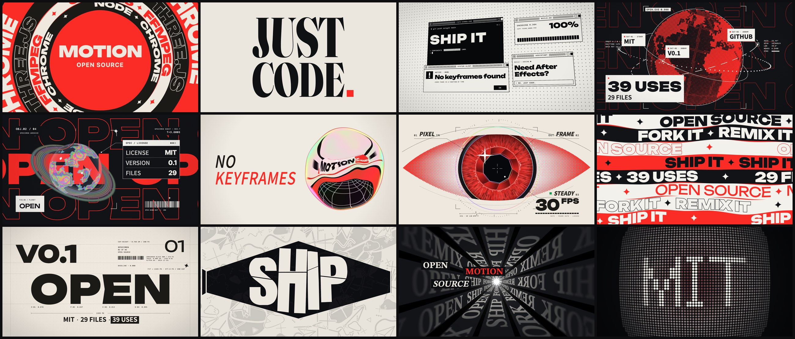

# fifi-video

Video tools that are just code. Every frame is HTML / Canvas / JS, rendered frame by frame in Chrome. No generative video models.

<p align="center"></p>
<p align="center">Full promo: <!-- TODO: X · Bilibili · YouTube links --></p>

<details>
<summary><b>中文说明</b>（点击展开）</summary>

纯代码做视频的工具。每一帧都是 HTML / Canvas / JS，由 Chrome 逐帧渲染，不用任何视频生成模型。

### 已开放

| | 模块 | 状态 |
|---|---|---|
|  | **[motion 动画组件](motion/)**<br>29 个动画组件 + 渲染管线 | ✅ v0.1 |
| | 口播粗剪 | 即将开放 |
| | 后期 BGM、音效 | 即将开放 |
| | 封面 prompt | 即将开放 |
| | 标题 | 即将开放 |
| | [prompts/](prompts/)<br>一段 prompt 出一整支片 | ✅ |

### 这些组件有什么不一样

- **人工反馈精选，RLHF 式。** 每个组件都经过多轮：渲染 → 我逐帧看 → 打分 → 改。只有评到 A、B 的才放出来，其余的都砍掉了，所以看不出 AI 味。
- **可复用。** 组件只是一个画面框架，文字、图片、颜色、时间全是参数，同一个组件换个题目照样能用。
- **任何 AI 都能用。** 设计都在组件里，agent 只需要填文字和时间，所以不需要最新的模型。只要能读文件、能跑命令的编程 agent 都行。已测过：只给这个 repo，Claude Sonnet 5.5 和 Claude Haiku 5.5 各自做出一支 15 秒宣传片，出片检查全部通过。

### 快速开始

把这个 repo 交给你的编程 agent（Claude Code、Codex、Cursor……），对它说：

> 用 fifi-video/motion 做一支 10 秒 1920×1080 的片头，内容是“Hello, world”。

或者自己跑：

```bash
cd motion && npm install
bash scripts/new_project.sh ../my-video
bash scripts/build.sh ../my-video      # 逐帧渲染 → 音效 → my-video.mp4
```

需要 Node 18+、Google Chrome、Python 3（numpy）、ffmpeg。

### 参与贡献

欢迎报 bug、提修复、加新组件，见 [CONTRIBUTING.zh-CN.md](CONTRIBUTING.zh-CN.md)。

### 许可证

代码：[MIT](LICENSE)。自带字体沿用各自的 OFL / Apache 许可（`motion/components/explainer/xm-assets/fonts/`）。

作者：小火火Fifi。

</details>

[For AI agents](AGENTS.md)

## What's open

| | Module | Status |
|---|---|---|
|  | **[motion](motion/)**<br>29 animation components + render pipeline | ✅ v0.1 |
| | Rough cut for talking-head videos | soon |
| | BGM & sound effects | soon |
| | Cover prompts | soon |
| | Titles | soon |
| | [prompts/](prompts/)<br>Full one-prompt videos | ✅ |

## Why these components

- **Hand-picked with human feedback, RLHF-style.** I built each one through rounds of render → frame-by-frame review → rating → fix. Only the ones rated A or B ship; the rest were cut. That's why they don't look AI-made.
- **Reusable.** A component is only a frame. Words, images, colors and timing are all parameters, so the same component works for any topic.
- **Any AI can use them.** The design lives in the components. The agent only fills in words and times, so you don't need the newest model. Any coding agent that can read files and run shell commands will do. Tested: given only this repo, Claude Sonnet 5.5 and Claude Haiku 5.5 each made a 15-second promo that passed every build check.

## Quick start

Point your coding agent (Claude Code, Codex, Cursor…) at this repo and say:

> Use fifi-video/motion to make a 10-second 1920×1080 intro that says "Hello, world".

Or by hand:

```bash
cd motion && npm install
bash scripts/new_project.sh ../my-video
bash scripts/build.sh ../my-video      # frames → sound → my-video.mp4
```

Needs Node 18+, Google Chrome, Python 3 (numpy), ffmpeg.

## Contributing

Bug reports, fixes and new components are welcome. See [CONTRIBUTING.md](CONTRIBUTING.md).

## License

Code: [MIT](LICENSE). Bundled fonts keep their own OFL / Apache licenses (`motion/components/explainer/xm-assets/fonts/`).

Made by 小火火Fifi.
