# motion

29 motion-graphics components and the pipeline that renders them. Every frame is HTML / Canvas / three.js, rendered in Chrome; sound effects are synthesized in code.

Each component was reviewed frame by frame by a human before it shipped. Content (text, images, colors, timing) is all parameters, so the same component works for any topic.

- Agents: read [SKILL.md](SKILL.md) first.
- Humans: [Quick start](../README.md#quick-start), then click a component below for its demo, when to use it, a working snippet, options and style.

## Type and titles

| | | |
|---|---|---|
| <a href="docs/components/bigtype.md">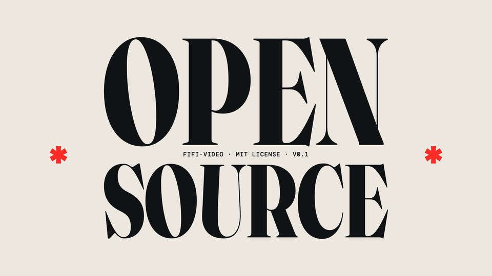</a> **[Big Type](docs/components/bigtype.md)** Huge condensed headline type that hard-cuts in on the keyword and holds still; also name cards, quotes and equal-width poster blocks. | <a href="docs/components/title.md">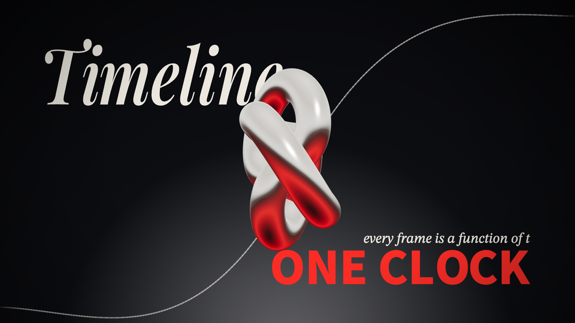</a> **[Concept Title](docs/components/title.md)** Dark title card: one subject, an italic concept name resolving letter by letter, a heavy second line and an optional arc. | <a href="docs/components/type.md">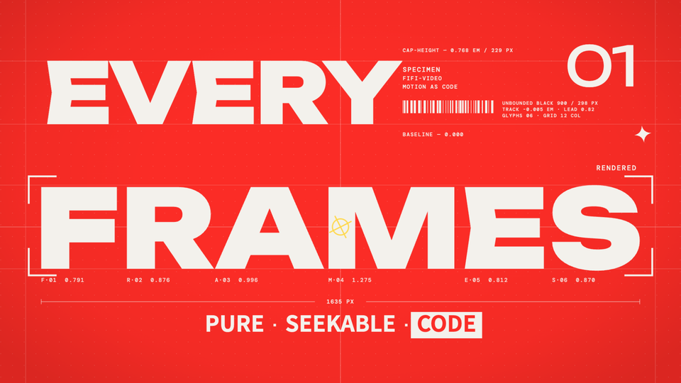</a> **[Type Specimen](docs/components/type.md)** One word as a type specimen sheet: outline letters fill in, tags highlight one by one, optional crosshair lock-on. |
| <a href="docs/components/tag.md">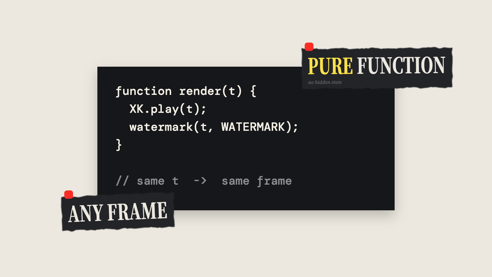</a> **[Highlight Tags](docs/components/tag.md)** Short paper-strip or slanted-bar labels over any shot, with yellow keyword highlight, staircase stacks and either/or pairs. | <a href="docs/components/tilt.md">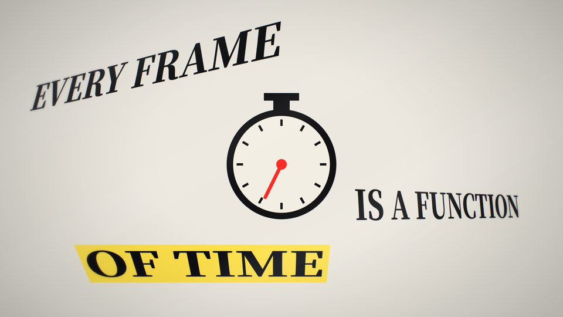</a> **[Tilted Type](docs/components/tilt.md)** Short phrases on tilted perspective planes around one subject, sliding in as spoken, with depth blur and a slow pull back. | <a href="docs/components/roll.md">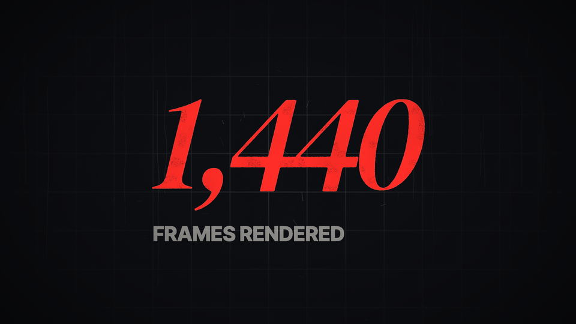</a> **[Number Roll](docs/components/roll.md)** A big number flips through values, slows down and lands, optionally from a tilted close-up that pulls back. |
| <a href="docs/components/cuts.md">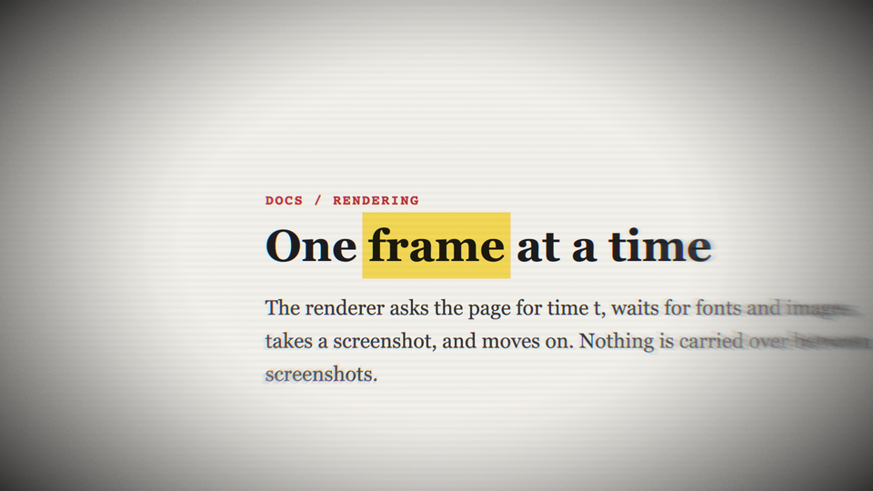</a> **[Keyword Match Cuts](docs/components/cuts.md)** Fast full-screen screenshot cuts with the same word landing on the same spot, then a yellow sweep and pull back. |  |  |

## Evidence and data

| | | |
|---|---|---|
| <a href="docs/components/xs-text.md">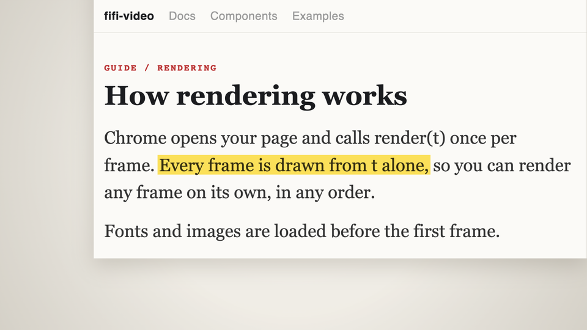</a> **[Evidence & Quote](docs/components/xs-text.md)** A real screenshot in a browser frame with push-in and yellow sweep, or a quote reset in big serif with one phrase highlighted. | <a href="docs/components/xs-screen.md">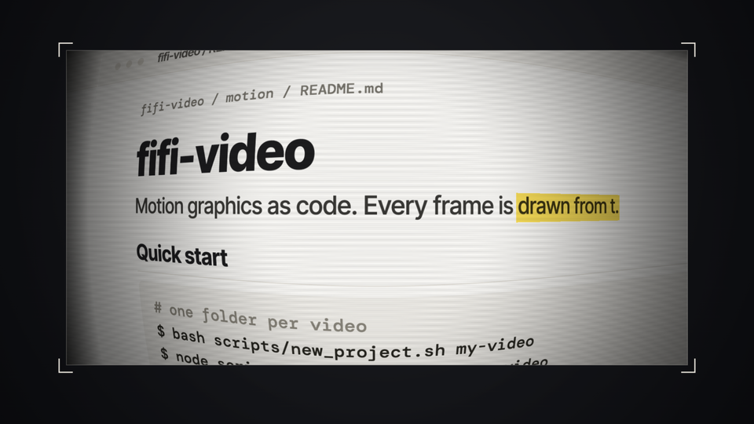</a> **[Screen shot](docs/components/xs-screen.md)** Your screenshot filmed like a phone pointed at a monitor: fisheye, moire and vignette, pushing in to one line with a yellow highlight sweep. | <a href="docs/components/xs-rank.md">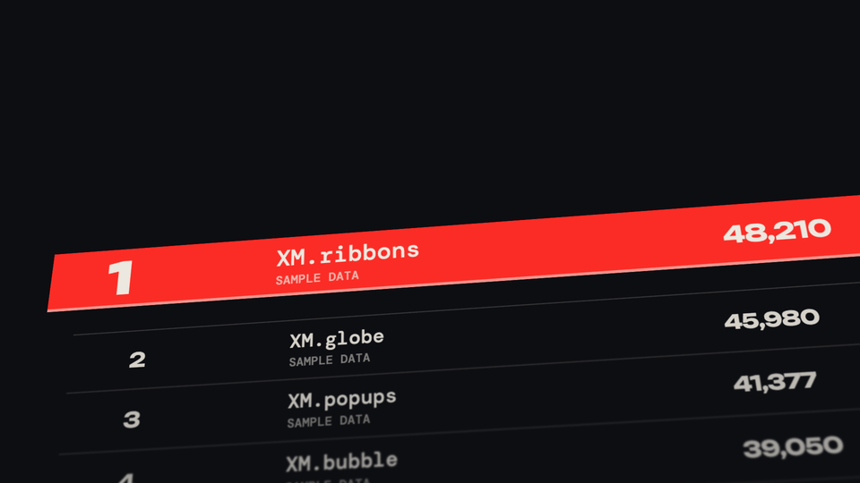</a> **[Ranking climb](docs/components/xs-rank.md)** A tilted 3D leaderboard where the target row climbs past the others, lands, and the camera pulls back to the whole board (optionally cut to the real screenshot). |
| <a href="docs/components/thirds.md">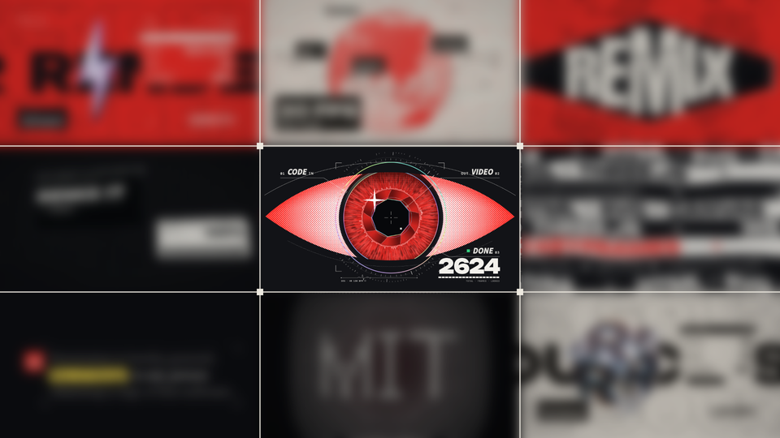</a> **[Grid focus](docs/components/thirds.md)** Thirds lines split a busy picture into nine cells; one cell stays sharp, the rest blurs, and the focus moves with the voiceover. | <a href="docs/components/pile.md">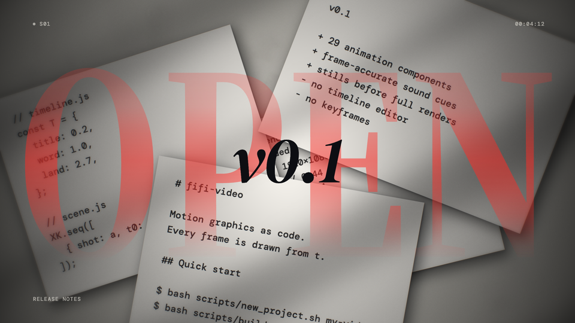</a> **[Paper Pile](docs/components/pile.md)** Printed sheets scatter into a pile, the pile dims, and a small number and a huge translucent word are stamped on top. | <a href="docs/components/wall.md">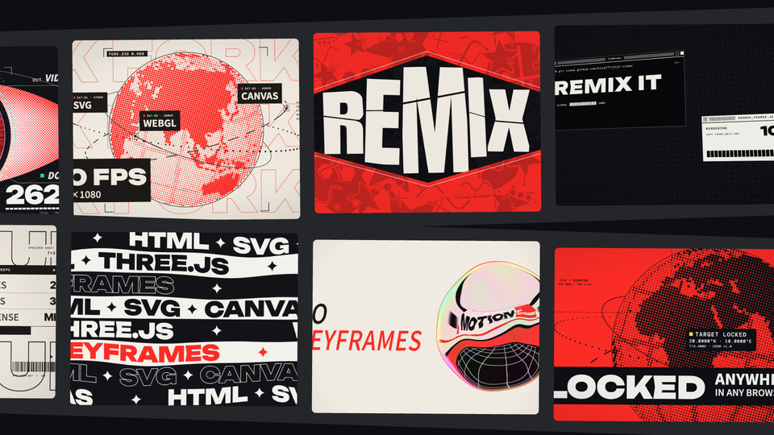</a> **[Whole-wall swap](docs/components/wall.md)** Two tilted strips of different screenshots slide in, then every cell hard-cuts to the same picture on one word. |
| <a href="docs/components/strip.md">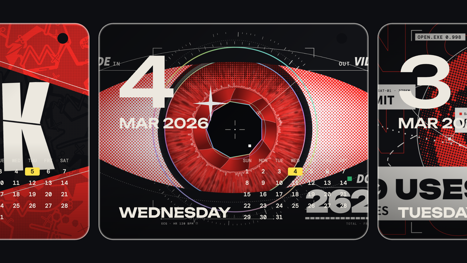</a> **[Calendar card strip](docs/components/strip.md)** A row of dated glass cards with real screenshots that stops on the days you name and motion-blurs past the rest. |  |  |

## Showcase shots

| | | |
|---|---|---|
| <a href="docs/components/popups.md">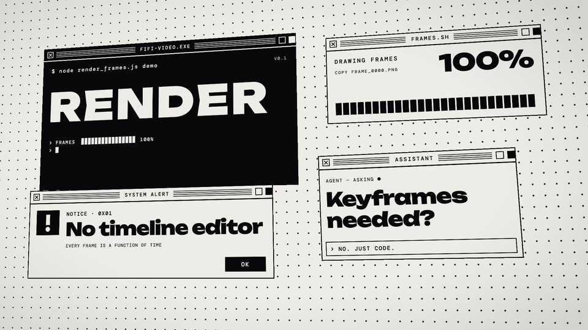</a> **[Window barrage](docs/components/popups.md)** Retro system windows pop up one after another on a tilted dotted desk; XM.loading follows with a big progress window that counts to 99 and flips to done. | <a href="docs/components/specimen.md">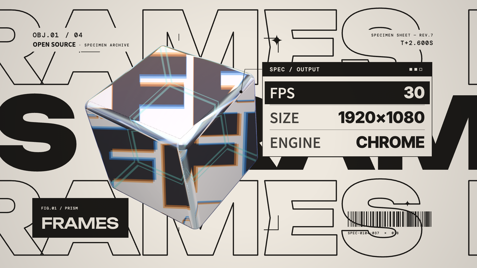</a> **[Specimen card](docs/components/specimen.md)** A 3D glass prism (or bolt, planet, mind) floats over a scrolling word wall with a label tag and a spec sheet whose rows type in; XM.specimenGrid shows four. | <a href="docs/components/bubble.md">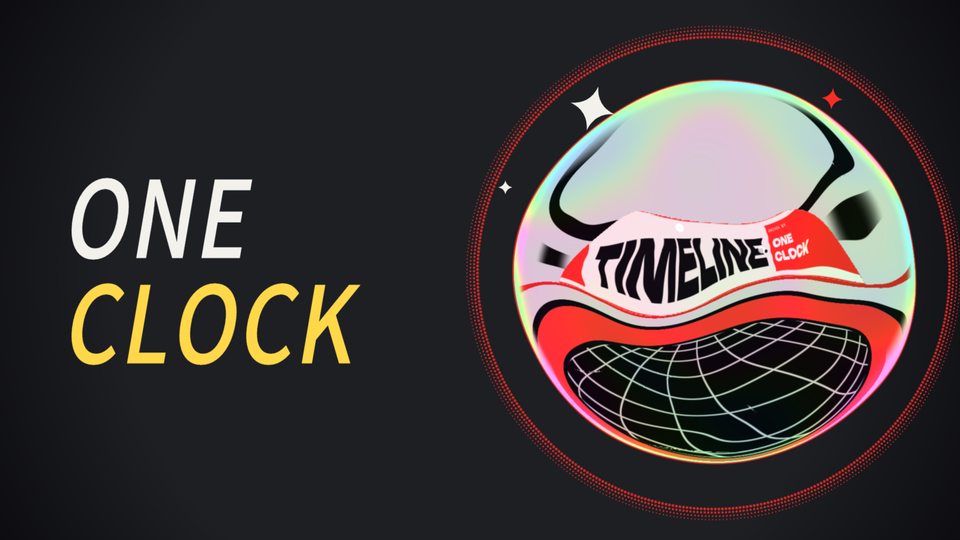</a> **[Liquid glass bubble](docs/components/bubble.md)** A breathing iridescent glass bubble beside a short statement rising letter by letter; it can swing sides, split into two cells and merge back. |
| <a href="docs/components/globe.md">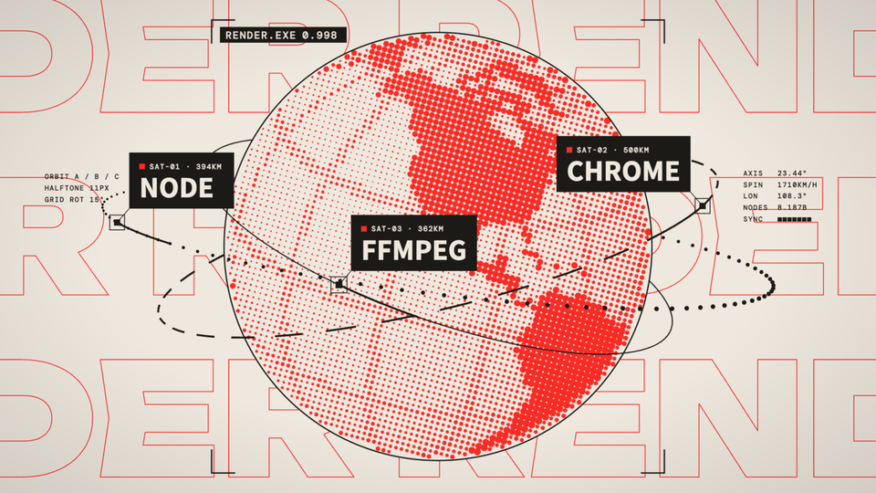</a> **[Halftone globe](docs/components/globe.md)** A spinning halftone-dot globe with orbiting satellite labels, hard-cutting to a close-up where a crosshair locks onto a latitude/longitude. | <a href="docs/components/ribbons.md">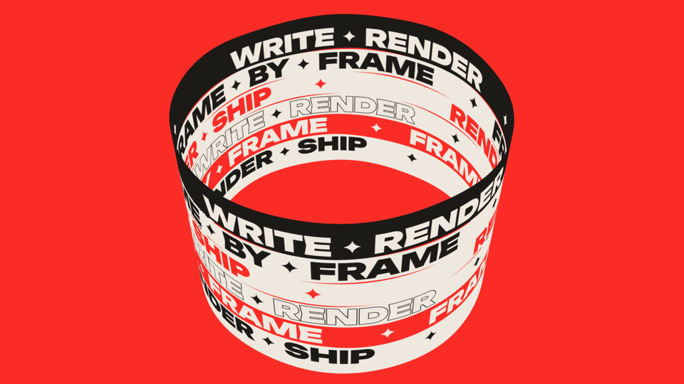</a> **[Text ribbons](docs/components/ribbons.md)** A full-screen wall of wavy text ribbons that swap colors, roll up into a spinning cylinder and land one word in its center. | <a href="docs/components/scan.md">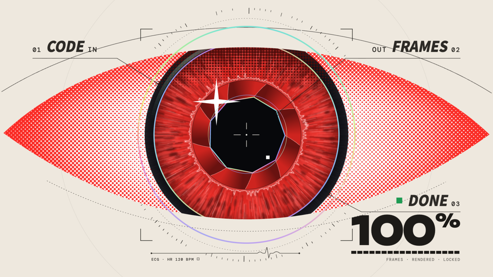</a> **[Iris scan](docs/components/scan.md)** A huge halftone eye opens, two labels point at iris and pupil, then it pushes in while a readout counts up and locks. |
| <a href="docs/components/squeeze.md">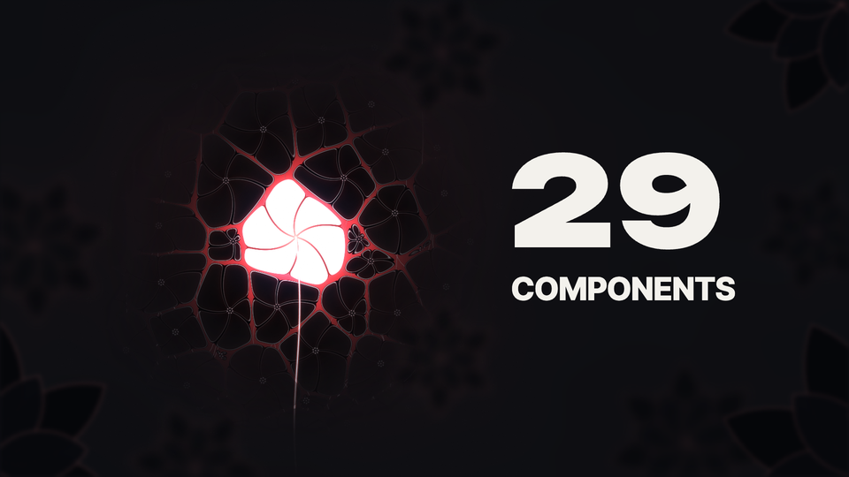</a> **[Flower squeeze](docs/components/squeeze.md)** A white hero flower lights up, dark flowers flood in and pack into glowing cells, and the hero is squeezed small (GPU render). | <a href="docs/components/lens.md">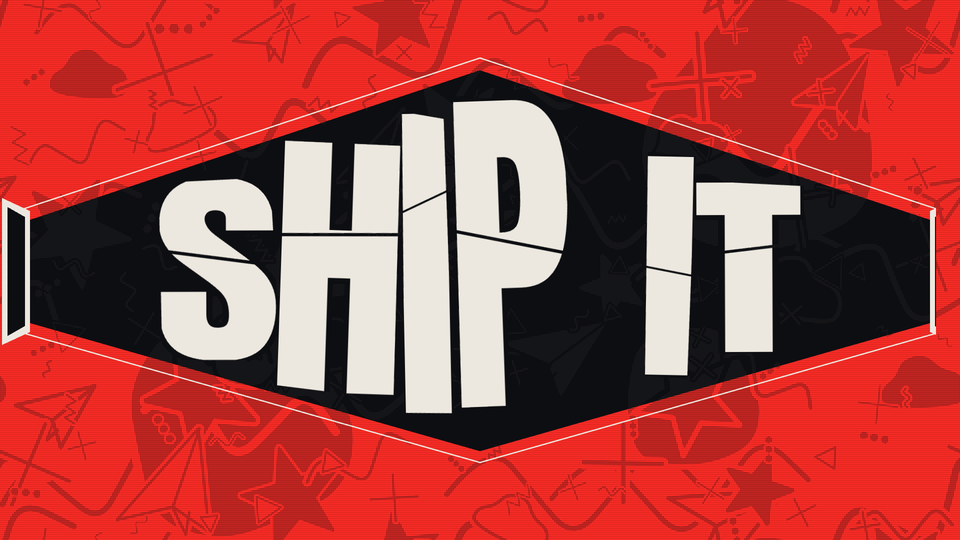</a> **[Diamond lens](docs/components/lens.md)** A diamond window wipes open, an icon trail dashes through, and one English word slams in letter by letter. | <a href="docs/components/corridor.md">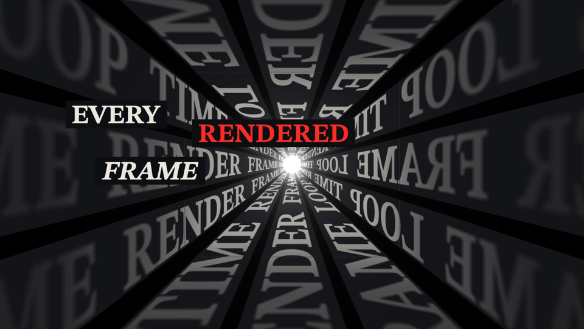</a> **[Text corridor](docs/components/corridor.md)** Four walls of repeating words stream toward the vanishing point while a short phrase stacks up in front. |
| <a href="docs/components/notify.md">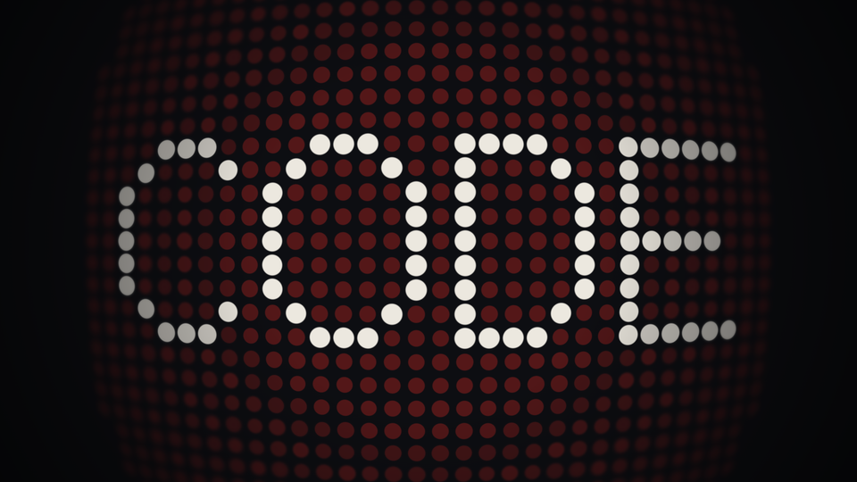</a> **[Dot-matrix notify](docs/components/notify.md)** One tile with a counting badge pulls back into a grid, then pushes into an LED wall whose dots spell a word. | <a href="docs/components/emerge.md">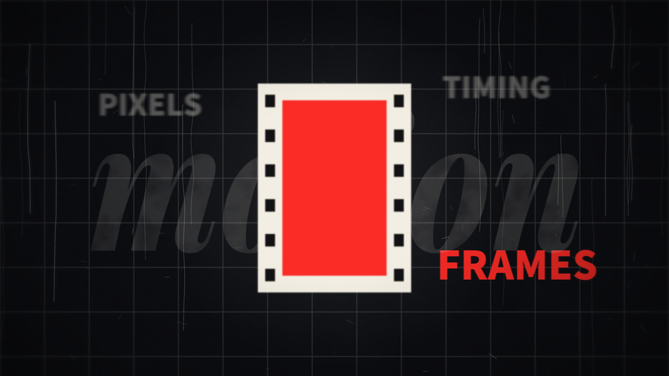</a> **[Emerge](docs/components/emerge.md)** A subject emerges from the dark while words drift past in real depth of field, with focus pulls between them. | <a href="docs/components/doodle.md">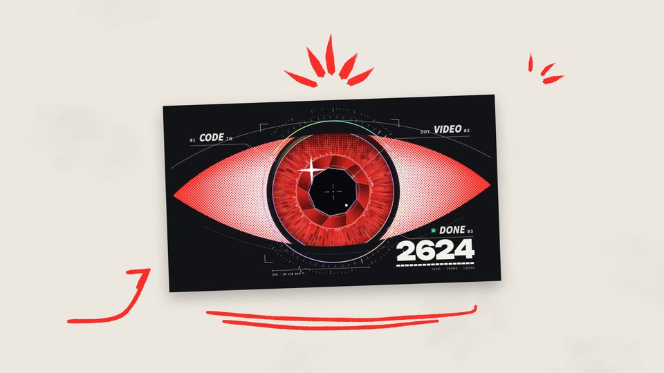</a> **[Hand-drawn doodles](docs/components/doodle.md)** Brush and marker marks (rays, arrows, underlines, sparks, bolts) drawn stroke by stroke around a subject, never on text. |

## Transitions and texture

| | | |
|---|---|---|
| <a href="docs/components/trans.md">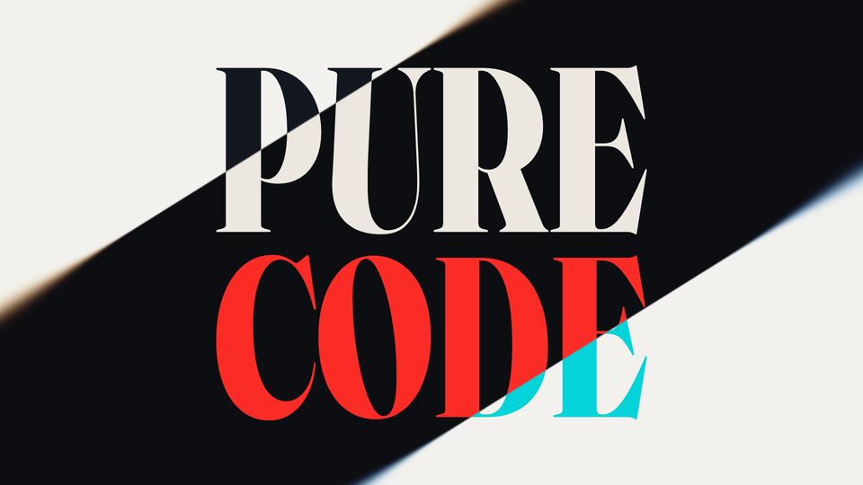</a> **[Transitions: whip, slash, defocus](docs/components/trans.md)** Full-frame canvas transitions for XK.seq: motion-blurred whip pan, diagonal slash out of an inverted frame, blur-out swap. | <a href="docs/components/trans2.md">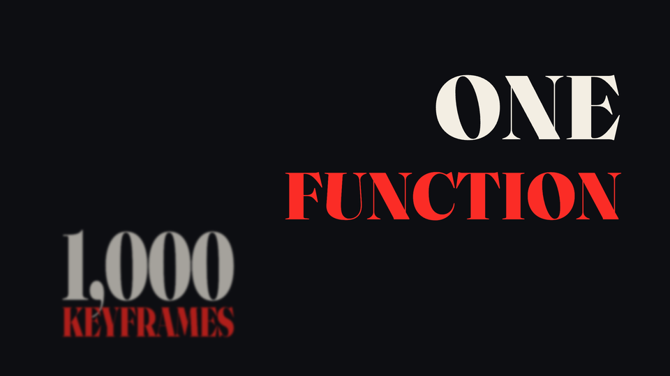</a> **[Transitions: recede, leak](docs/components/trans2.md)** Canvas transitions for XK.seq: the previous shot shrinks into a corner as context while the next falls in; a warm light leak to one white frame that closes a chapter. | <a href="docs/components/tex.md">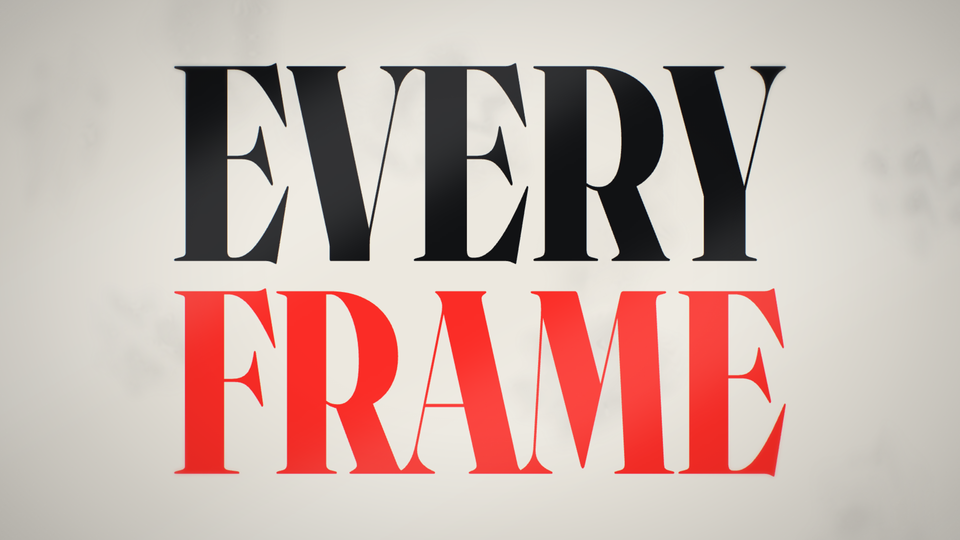</a> **[Texture layer](docs/components/tex.md)** Paper, dark grid or colour-wash stage plus window light, vignette, grain and a slow push for any full-screen shot. |

## Pipeline

| Script | What it does |
|---|---|
| `scripts/new_project.sh <dir>` | new project: skeleton, components, fonts |
| `scripts/render_frames.js <dir> [--stills t ...]` | render every frame (or a few stills to `qa/`), check fonts and page errors |
| `scripts/build.sh <dir> [--music song.mp3] [--out x.mp4]` | frames → sound effects → music mix → MP4 → checks |
| `scripts/sfx_kit.py --list` | the sound-effect kit ([sfx-kit/README.md](sfx-kit/README.md)) |
| `scripts/capture.js <url> out.png --scale 3` | capture a web page as a sharp screenshot |
| `scripts/clip_frames.py`, `scripts/srt_times.py` | cut a video into frames; read keyword times from an SRT |

Fonts bundled with components and their licenses: [components/explainer/xm-assets/fonts/](components/explainer/xm-assets/fonts/README.md).
