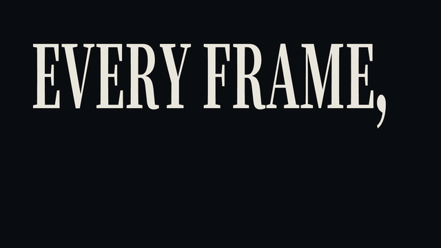

# Big Type · `XM.bigType`



Huge, condensed headline type that hard-cuts in on the keyword and then holds perfectly still. The same file also has `XM.bigName` (a name card) and `XM.bigQuote` (a quote that appears one sentence at a time).

## When to use

- A conclusion word, a rhetorical question or a one-line verdict that should hit the screen as the narrator says it.
- A two-part statement: the first line cuts in, then the second line cuts in on top when it's spoken.
- A named concept or a short quote the viewer should read (`bigName`, `bigQuote`).
- Don't use it to prove something: big type isn't evidence. Use `XS.doc` / `XS.evidence` first, then land the conclusion here. Don't use it for a whole sentence of explanation either. Leave that to subtitles.

## Usage

```js
// timeline.js
const T = { a1: 0.15, a2: 0.9, b0: 2.2, b1: 2.3, b2: 2.5 };

// scene.js
XK.theme('night', { accent: '#FB2C26', accent2: '#FFD84A' });
const rows = XM.bigType({ tone: 'ink', layout: 'rows',
  lines: [{ text: 'EVERY FRAME,', at: T.a1 }, { text: 'IS CODE', at: T.a2, color: 'accent' }],
  subtitle: 'keep', hud: false });
const block = XM.bigType({ tone: 'paper', layout: 'block',
  lines: [{ text: 'OPEN', at: T.b1, from: 'left' }, { text: 'SOURCE', at: T.b1 + .12, from: 'right' }],
  mid: { text: 'FIFI-VIDEO · MIT LICENSE · V0.1', at: T.b2 },
  ornaments: { kind: 'star', place: 'sides', at: T.b2 },
  subtitle: 'keep', hud: false });
XK.seq([
  { shot: rows, t0: 0, tin: 'cut', drift: false },
  { shot: block, t0: T.b0, tin: 'cut', drift: false },
]);
window.SFX_CUES.push(...rows.cues, ...block.cues);
```

Every `at` is an absolute time in seconds from the `T` table. Put each one on the frame where the word is spoken. The component cuts in 2 frames early by itself (`lead`).

## Options

| option | default | what it does |
|---|---|---|
| `lines` | required | `[{ text, at, color, align, size, split }]`. One entry per line, and each line can have its own `at`. |
| `layout` | `'rows'` | `'rows'` (lines span the frame), `'around'` (each line splits left and right of a subject), `'behind'` (the whole group sits behind the subject's centre line), `'block'` (equal-width poster block, see below) |
| `tone` | `'ink'` | Stage colour: `'ink'`, `'paper'` or `'accent'`. Flat, with nothing else drawn. |
| `color` | `'fg'` | Text colour: `'fg'`, `'accent'` or `'#hex'`. Can also be set per line. |
| `squeeze` | `'auto'` | Horizontal condense (glyph width ÷ height). Auto picks a value between 0.40 and 0.52 so the side gaps stay balanced. |
| `subject` | none | `{ src, x, y, h, side, edge, column }`: a transparent PNG cutout standing **in front of** the type. |
| `en` | none | `{ text }`: a small English line under the big type. Used for name cards. |
| `until` / `out` | none | When the type cuts out: `until` is the next sentence's start (it leaves 2 frames early), `out` is an exact time. |
| `enter` | `'cut'` | `'sweep'` (letters resolve left to right), `'rise'` (fade and drift up), `'slide'` (letters slide in) |
| `fill` / `wear` / `alpha` / `skew` | flat / 0 / 1 / 0 | `'grad'` for printed grey ink, wear for a worn surface, translucency, slant |
| `subtitle` | `'drop'` | `'drop'` exports `shot.subs` so the subtitle can skip these words; `'keep'` exports nothing for that. |
| `sfx` | `kacha` / `pa` | One hit on entry, and one per later line. `false` turns it off. |
| `hud` | `{ tl: 'FIG' }` | Corner labels `{ tl, bl, br }`, or `false` |

For one or two short words ("TRY / INKWELL"), `layout: 'block'` fills the frame better than `'rows'`.

**Equal-width block** (`layout: 'block'`): every line is scaled to the same width, so short words get taller. `lines[i].from` (`'left' | 'right' | 'top' | 'bottom'`) slides that line in with no bounce. `mid: { text }` adds a small mono note in the gap between lines. `ornaments: { kind: 'star' | 'x' | 'dot', place: 'sides' | 'ends' }` adds marks to the block. `blocks: [{ lines, … }, …]` hard-swaps whole blocks inside one shot. Latin lines use Fraunces Black.

**Name card** `XM.bigName({ name: { text, at }, en: { text }, subject })`: paper stage, the name fills one side and an optional subject stands on the other.
**Quote** `XM.bigQuote({ parts: [{ text, at }, …], fade: .4, maxLines: 3 })`: each sentence fades from light grey to ink as it's spoken.

## Style

- Condensed heavy serif: Noto Serif SC 900 for `rows` / `around`, Fraunces 144 Black for `block`. Glyphs are as tall as 72 % of the frame, with near-zero tracking.
- Flat colour only: cream on ink, ink on paper, or one accent line. No glow, shadow or outline.
- Layering is always stage → type → subject → HUD, so a subject may cover part of a word.
- The only motion is hard cuts (line by line), the optional block slide-ins and the quote fade. Pairs well with an evidence shot right before it.

## Notes

- Write the text as it's spoken. Full stops (`.`) are removed and the line breaks there. Commas stay at the **end** of a line, and the next line starts after them.
- Always use `drift: false` in `XK.seq`, because the type must not move.
- For `around` with a hand-drawn subject (`subject.draw`), you must give `subject.column: [x0, x1]`.
- Returns `{ L, update, cues, subs, times, api }`. `api.fit()` reports the condense and gaps it actually used.
