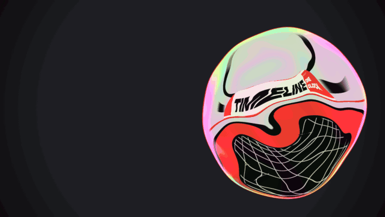

# Liquid glass bubble · `XM.bubble`



A breathing, iridescent glass bubble reflects a rotating ribbon of text while a short statement rises letter by letter beside it; it can swing to the other side, split into two cells, and merge back.

## When to use

- A close-up on one concept ("this is the timeline").
- "X is not Y, it's Z": write the statement, then `swing` to reveal the answer column.
- "It splits in two" / "two sides": `split` with two labels; add `merge` for "…and they become one again".
- Not for data or evidence. It is a close-up; use it once per video and surround it with charts or screenshots.

## Usage

```js
// timeline.js
const T = { bubble: 0, l1: .4, l2: .8, beat: 1.5, split: 2.1 };

// scene.js
XK.theme('night', { accent: '#FB2C26', accent2: '#FFD84A' });

const SH = {};
SH.bubble = XM.bubble({
  at: T.bubble,
  band: { text: 'TIMELINE', panel: ['ONE', 'CLOCK'], tag: 'DRIVEN BY' },
  say: [{ text: 'ONE', at: T.l1 }, { text: 'CLOCK', at: T.l2, color: 'accent2' }],
  beats: [T.beat],
  split: { at: T.split, labels: ['PICTURE', 'SOUND'] },
  side: 'right', box: false, hud: false, tags: ['', ''],
});

XK.seq([{ shot: SH.bubble, t0: T.bubble, tin: 'cut', drift: { s0: 0, s1: .04, x: 0, y: 0 } }]);
```

For a light stage wrap the whole call: `XK.tone('paper', () => XM.bubble({ … }))`.

## Options

| option | default | what it does |
|---|---|---|
| `at` | `0` | bubble inflates (0.5 s, slight overshoot), then wobbles to rest |
| `say` | `[]` | `[{ text, at, color, size }]` lines to read; letters rise one by one |
| `band` | from `sub` | reflected text ribbon: `'WORD'` or `{ text, panel: [a, b], tag }` (decoration) |
| `beats` | `[]` | times for a halftone ring + sparkles + a small squeeze |
| `swing` | — | `{ at }` bubble swings across; lines with `at ≥ swing.at` form the answer column |
| `split` | — | `{ at, labels: ['A', 'B'] }` divides into two cells, labels type in below |
| `merge` | — | `{ at, label }` after a split: cells fuse back into one |
| `side` | `'right'` | bubble side; text goes on the other side |
| `size` | `780` | bubble diameter in px |
| `sub` | — | `{ text, at }` small mono echo line under the text column |
| `hit` | `false` | faster timing (×0.75) for openers |
| `box`, `hud`, `tags` | on | specimen frame, corner HUD and column labels; set `false` / `['', '']` to hide |
| `per` | `0.06` | delay between letters |

## Style

Raymarched soft body with thin-film rainbow edges, pearl rim and a thin accent outline; the reflection holds a sky, black arcs, the text ribbon, an accent liquid and a white grid floor. Statement text is a slanted, slightly condensed sans; the keyword line takes `color: 'accent2'` (fluorescent yellow). Works on night, paper and lab tones. Pairs well with a hard cut to a chart or screenshot after it.

## Notes

- Font size is set by the longest line in a column (max 210 px): keep lines to one or two words.
- After `swing` the first column is gone; after `split` all statement text is gone. Put what must stay in the answer column or in `split.labels` (≤ 4 short words each).
- `merge` needs a `split` at least 1.2 s earlier.
- The ribbon text is squeezed near the rim on purpose: never put information there.
- Use a small drift like the snippet; the default drift can push the bubble's edge off screen.
- In an English video pass `tags` (or `['', '']`); the default column labels are not English.
- Colors are resolved when the shot is built: wrap in `XK.tone(…)` instead of changing the theme later.
