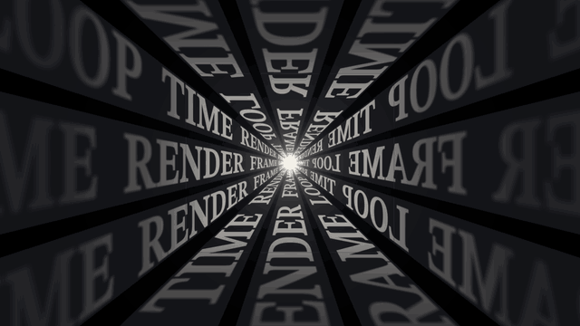

# Text corridor · `XM.textCorridor`



A square corridor whose four walls are covered in repeating words that stream toward the camera, while a short phrase stacks up word by word in front.

## When to use

- A line about repetition, loops, being pulled in or grinding through something ("every frame, rendered", "again and again").
- A hook at the start of a video (`hit: true`).
- At most once per video: it is full-screen and busy. Do not put two full-screen motion shots back to back.
- English only. The wall font is a Latin serif; CJK text raises a render error.

## Usage

```js
// timeline.js
const T = { in: 0, w1: .6, w2: 1.3, flash: 1.95, w3: 2.1 };

// scene.js
const corridor = XM.textCorridor({
  at: T.in, hit: true, layout: 'scatter',
  words: ['RENDER', 'FRAME', 'LOOP', 'TIME'],      // wall text: atmosphere only
  phrase: [
    { text: 'EVERY', at: T.w1 },
    { text: 'FRAME', at: T.w2, style: 'italic' },
    { text: 'RENDERED', at: T.w3, style: 'key' },
  ],
  flash: [{ at: T.flash, mode: 'pre' }],            // accent block right before the key word
  hud: false,
});
XK.seq([{ shot: corridor, t0: T.in, drift: { s0: 0, s1: .04, x: 0, y: 0 } }]);
window.SFX_CUES.push(...corridor.cues);
```

Put every phrase word's `at` on the moment the voice says it; 0.6–0.8 s apart reads best.

## Options

| option | default | what it does |
|---|---|---|
| `at` | `0` | entrance (seconds). Explain mode fades in over 0.5 s; hook mode bursts open from the vanishing point |
| `words` | required | wall words, repeated into bands; uppercased automatically |
| `phrase` | `[]` | `[{ text, at, style, x, y, size, sfx }]` the words to read. `style`: `'roman'`, `'italic'`, `'key'` (accent colour). `size` default 84 px |
| `layout` | `'left'` | `'left'` staircase on the left half, or `'scatter'` around the vanishing point |
| `flash` | `[]` | `[{ at, word, mode }]` a solid accent block. `'side'` sits next to the newest word, `'pre'` holds the place of the next word |
| `hit` | `false` | hook mode: burst entrance, 3× speed, stepped (strobing) wall motion, slight RGB split, hard-cut phrase |
| `speed` | `1` | wall flow speed |
| `dim` | `.68` | wall brightness; lower it (`.55`) when the phrase has 4+ words |
| `vp` | `[960, 540]` | vanishing point |
| `tone` | from caller | `'ink'` or `'paper'` |
| `hud` | `{ tl: 'FIG' }` | corner labels; `false` turns them off |

## Style

- STIX Two Text serif, all caps, compressed (`squeeze: .55`). Wall text is the foreground colour of the stage, brightest just around the centre and fading to near black at the edges.
- Phrase words are cream on solid ink blocks that wipe in left to right (hard cut in hook mode); the `key` word uses the accent colour.
- A small white star and haze sit at the vanishing point (ink stage only).
- Follow it with a calm shot (a plain card or big type) so the eye can rest.

## Notes

- `words` is atmosphere. Anything the viewer must read goes in `phrase`.
- With `layout: 'left'`, long words can reach the vanishing point; set `x` / `y` per word or move `vp` right.
- `flash` with `mode: 'pre'` needs a phrase word after it; after the last word use the default `'side'`.
- Use a zero-pan drift as above; the default drift can push the left-side phrase out of frame.
- The wall is a GPU shader on the shared WebGL renderer; frames take roughly 0.2 s each.
