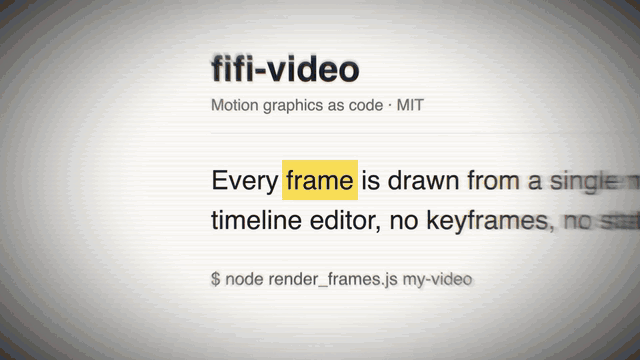

# Keyword Match Cuts · `XM.wordCuts`



A fast run of full-screen screenshots in which the same word lands on the same screen point every time, like flipping through a book. It can then hold on the last page, sweep the word in yellow and pull back to show the whole page.

## When to use

- "This word is everywhere": the same term across many docs, posts or changelogs.
- A version or product run ("five releases, one name"): a run of title cards or logos that stops on the one you're talking about (see `backdrop` / `over`).
- Not for reading. Each page is on screen for a tenth of a second, so use `XS.evidence` or `XS.doc` when the viewer must read a sentence.
- Not with mixed dark and light pages. Fast cuts between them flash (see Notes).

## Usage

```js
// timeline.js
const T = { cut: 0.1, sweep: 1.75, pull: 2.4 };

// scene.js: box = pixel box of the word in each screenshot [x, y, w, h]
const PAGES = [
  { src: 'assets/pages/p1.png', box: [670, 738, 307, 138] },
  { src: 'assets/pages/p2.png', box: [868, 393, 594, 219] },
  { src: 'assets/pages/p3.png', box: [848, 792, 361, 138] },
  { src: 'assets/pages/p4.png', box: [650, 694, 329, 132] },
  { src: 'assets/pages/p5.png', box: [2554, 543, 423, 177] },
  { src: 'assets/pages/p6.png', box: [300, 856, 325, 123] },
];
const cuts = XM.wordCuts({
  at: T.cut, pages: PAGES.map(p => ({ ...p, on: 'light' })),
  order: [0, 1, 2, 3, 4, 5, 0, 2, 3, 4, 5, 1], rhythm: { from: 3, to: 6 },
  land: { sweep: { at: T.sweep }, pull: { at: T.pull, dur: 1.4, fit: 'page' } },
  hud: false,
});
XM.tex.use(cuts, { post: XM.wordCuts.POST });   // edge blur, fringe, heavy vignette
XK.seq([{ shot: cuts, t0: 0, tin: 'cut', drift: false }]);
window.SFX_CUES.push(...cuts.cues);
```

The demo pages are local HTML files captured at 3× (`node scripts/capture.js page.html page.png --scale 3`). Get the word box from any OCR tool or from `getBoundingClientRect()` × scale.

## Options

| option | default | what it does |
|---|---|---|
| `pages` | required | ≥ 2 items `{ src, box, on: 'light' \| 'dark', rot, zoom, dx, dy, label }` |
| `at` | required | Time of the first cut |
| `order` / `count` | each page once | Cut order (repeats allowed), or a number of cuts that cycles through the pages |
| `rhythm` | 3 | Frames per page: a number, an array, `{ from, to }` to speed up or slow down, or `{ times: [...] }` to cut on spoken words. The last page holds. |
| `align` | screen centre | `[x, y]` where the word lands |
| `anchor` | `[.5, .5]` | Which point of the box is aligned. Use `[0, .5]` for the left edge. |
| `fit` / `size` / `scale` | `'h'` / 110 | `'h'`: box height becomes `size`. `'w'`: box width becomes `size`. `'none'`: pixel ratio × `scale`. |
| `mark` | `{ cuts: 'sweep' }` | Yellow highlight on every page. `cuts: false` highlights only after landing. `fixed: { w, h }` uses one fixed-size highlight. |
| `land` | none | `{ sweep: { at, dur }, pull: { at, dur, fit: 'page' \| number } }`: hold, highlight, then pull back |
| `zoom` / `turn` | slow push .82 → 1 → 1.03 | Camera keyframes `[[t, s, ease]]` / slow overall rotation `[start, end]` |
| `enter` / `exit` | none | `{ kind: 'flash' }`: clear in from white and blur / flash out into the next shot |
| `lens` | on | Radial streak and faint scanlines. Use `{ streak: false, scan: false }` to turn them off. |
| `backdrop` | `'page'` | `'stage'` puts transparent logos on the stage colour. `(g, t, P) => {}` draws your own background. |
| `over` | none | `(g, t, { ci, page, landed }) => {}` draws an extra layer per cut, e.g. a name that changes with each logo |
| `sfx` | `{ run: 'riffle' }` | One riffle sound for the whole run, plus `paper` on the sweep. Single cuts are silent. |

## Style

- Pages fill the frame. The area outside a page uses that page's own background colour.
- The camera pushes in from .82 to 1 during the run, then creeps slowly. With `XM.wordCuts.POST`, edges blur and get a radial streak, corners go dark, and the centre stays sharp.
- Highlights are fluorescent yellow (multiply on light pages). Words are never boxed or bracketed.
- Works well right before a big-type conclusion or an evidence shot that zooms into one of the pages.

## Notes

- **Sharp sources only:** on-screen magnification (page scale × camera zoom) must stay ≤ 1.1. Above 1.25 it's an error. Recapture at a higher `--scale` instead of upscaling.
- **Photosensitivity:** the component measures each cut's brightness. More than 3 big jumps in one second is an error, so keep all pages light (or all dark).
- For version or logo runs with nothing to highlight, use `mark: { cuts: false }` and leave out `land`.
- Use only screenshots you're allowed to show.
