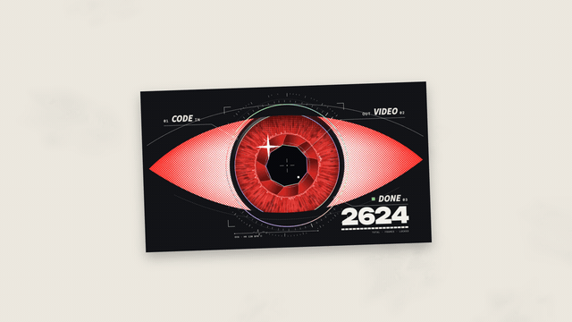

# Hand-drawn doodles · `XM.doodle`



A few hand-drawn marks (rays, arrows, underlines, sparks, bolts) drawn stroke by stroke around a subject, with pressure, ink pooling and a dry-brush tail, then gently "boiling".

## When to use

- The reaction beat of a sentence ("that's when it clicked", "it broke"): a few strokes around the object, person or screenshot it is about.
- One or two places per video, not as decoration.
- Never on text: doodles do not circle or underline keywords. Keywords get the fluorescent yellow highlight.

## Usage

```js
// timeline.js
const T = { rays: .3, arrow: .8, line: 1.3, spark: 1.8 };

// scene.js
const CARD = XM.image('assets/c-scan.png');
const card = (g) => {                       // the subject: one of our renders as a tilted print
  if (!CARD.ok) return;
  g.save(); g.translate(960, 560); g.rotate(-2 * Math.PI / 180);
  g.shadowColor = 'rgba(18,18,20,.28)'; g.shadowBlur = 40; g.shadowOffsetY = 18;
  g.drawImage(CARD.img, -480, -270, 960, 540); g.restore();
};
const sh = XM.doodle({
  tone: 'paper',
  back: (g, t, P) => { XM.DS.stage(g, P); card(g); },
  items: [
    { kind: 'rays', at: T.rays, x: 960, y: 270, r0: 50, r1: 190, dir: 0, spread: 120, n: 5 },
    { kind: 'arrow', at: T.arrow, x: 200, y: 930, to: [230, -150], bend: .25, lw: 12 },
    { kind: 'underline', at: T.line, x: 980, y: 905, w: 760, double: true, lw: 11 },
    { kind: 'spark', at: T.spark, x: 1530, y: 250, n: 3, len: 85, dir: 40 },
  ],
  hud: false,
});
XM.tex.use(sh, { stage: { kind: 'paper', stains: .2, seed: 4 } });
XK.seq([{ shot: sh, t0: 0, drift: false }]);
window.SFX_CUES.push(...sh.cues);
```

Other ways to attach: `XM.doodle.on(shot, { items })` draws on top of an existing shot (under its HUD); `XM.doodle.layer({ items })` returns `{ draw(g, t, P) }` for your own shot. Use `front(g, t, P)` to draw a cut-out subject over the strokes.

## Options

| option | default | what it does |
|---|---|---|
| `items` | required | one entry per mark: `kind`, `at`, `x`, `y` (required) plus shape sizes |
| `kind` | — | `bolt` (`len`, `n`, `w`, `dir`), `rays` (`n`, `r0`, `r1`, `dir`, `spread`), `circle` (`w`, `h`, `turns`, `lw`), `underline` (`w`, `double`, `lw`), `arrow` (`to: [dx, dy]`, `bend`), `spark` (`n`, `len`, `dir`), `splat` (`r`), `wave` (`len`, `amp`, `n`), `path` (`pts`) |
| item `out` | none | time, or `{ at, mode: 'cut' \| 'fade' \| 'erase' }` |
| item `enter` | `'draw'` | `'draw'` stroke by stroke (`dur` ≈ .32 s), `'cut'` appears at once |
| item `style` | per kind | `'brush'` (pressure, tapered, dry tail) or `'marker'` (even width, round ends) |
| `col` | accent | stroke colour; one colour at a time |
| `boil` | `{ rate: 7.5, amp: 1.4 }` | redraw jitter after drawing; `false` freezes the strokes |
| `ghost` | none | `{ dx, dy, a }` same-colour offset second pass |
| `back` / `front` | stage | draw the picture under / over the doodles |
| `tone`, `hud` | `'ink'`, required | stage tone; HUD corner labels or `false` |

## Style

- One colour per shot (the theme accent by default), no glow, no trails, no shaking.
- Every stroke is a variable-width ribbon: round start, heavier middle, ink pooling at corners, flicked dry-brush tail. Each mark gets its own seeded hand wobble, so no two strokes match.
- Sound: one `paper` cue per drawn group; `cut` entries stay silent.
- Pairs well with a cream `paper` stage from `XM.tex` and a single photo, render or object as the subject.

## Notes

- Draw outside the subject: above it, beside it, pointing at it, under it. `circle` / `underline` target an object, never words.
- Two colours visible at the same time raise a `console.error`.
- A flash check counts hard-cut appearances, `blink` and `jump`; more than 3 large changes in 1 s errors unless `unsafe: true`.
- `arrow.to` is an offset from `x, y`, not an absolute point.
