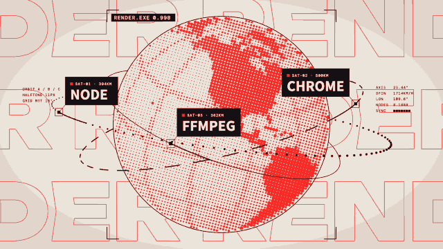

# Halftone globe · `XM.globe`



A spinning halftone-dot globe with orbits and labelled satellites in front of an outline word wall; it can hard-cut to a close-up where a crosshair searches and locks onto a latitude / longitude.

## When to use

- "Worldwide", "used everywhere": far view only, with 2–3 satellite labels for the key points, or a counting `title` plate ("30 FPS", "180 countries").
- "Where it happens": `close` + `lock` on the place, `lock.at` on the moment the place is named.
- From "global" down to one spot in one 5–6 s shot: `at` → `sats` → `close.at` → `lock.at`.
- Not for countries on the satellites: satellites ride orbits and don't point at the ground. Use `lock` for places. At most one far view and one lock per video.

## Usage

```js
// timeline.js
const T = { globe: 0, s1: .7, s2: 1.1, s3: 1.5, close: 2.4, lock: 3.7 };

// scene.js
XK.theme('night', { accent: '#FB2C26', accent2: '#FFD84A' });

const SH = {};
SH.globe = XK.tone('paper', () => XM.globe({
  at: T.globe, word: 'RENDER', lon: -40,
  sats: [{ label: 'NODE', at: T.s1 }, { label: 'CHROME', at: T.s2 }, { label: 'FFMPEG', at: T.s3 }],
  close: { at: T.close, word: 'ANYWHERE' },
  lock: { at: T.lock, lat: 20, lon: 10, label: 'ANYWHERE', sub: 'ANY LAPTOP' },
  tag: { en: 'RENDER.EXE', zh: '', side: ' ' }, hud: false,
}));

XK.seq([{ shot: SH.globe, t0: T.globe, tin: 'cut', drift: { s0: 0, s1: .04, x: 0, y: 0 } }]);
```

Build the shot in `scene.js` (before `window.ready`), so the land data is loaded before the first frame.

## Options

| option | default | what it does |
|---|---|---|
| `at` | `0` | globe rises in, rings expand, orbits draw out |
| `word` | `'WORLD'` | outline word wall (far view) and vertical solid word (close-up) |
| `lon` / `view` | `20` / `21.6` | longitude / latitude facing the camera after the entrance |
| `spin` | `36` | spin, degrees per second |
| `sats` | `[]` | up to 3 `{ label, at, th, speed }`; a label plate wipes in at `at` |
| `title` | — | `{ at, to, suf, sub, text }` bottom-left plate; `to` counts up from 0 |
| `close` | — | `{ at, bg: 'accent', word }` hard cut to the close-up; `close.at ≤ at` starts in close-up |
| `lock` | — | `{ at, lat, lon, label, sub, zoom }` crosshair locks on, black bar with LOCKED + label + sub |
| `lock.zoom` | — | seconds (or `true`): push into the target until the dots fill the screen |
| `orbits` / `beat` / `beats` | `true` / `0.5` / — | orbits on/off, orbit pulse period, or explicit pulse times |
| `wall` | `0.5` | word wall scroll speed multiplier (`0` = still) |
| `tag` | auto | small `.EXE` frame tag; set all three fields for an English video |
| `bg` / `color` | `'bg'` / `'accent'` | far-view background / dot and wall color |
| `hit` | `false` | faster opener timing |
| `hud` | on | `false` hides corner micro text |

## Style

Pure Canvas 2D (no WebGL): screen-space dot grid rotated 15°, big dots on land, small shaded dots on sea, 30° graticule. Far view: paper or dark stage, accent dots, outline wall in the wide display face. Close-up: accent background, dots switch to light or dark automatically, black bars with the wide display face and a sans label. Readable text is the satellite labels, `title`, and `lock.label` / `sub` only.

## Notes

- Latitude north and longitude east are positive; west and south are negative.
- Give the crosshair 1.0–1.6 s between `close.at` and `lock.at`; shorter looks like a skipped frame.
- Keep `lock.label` to about 10 characters and `sub` short, or the bar text shrinks.
- Satellite plates near the bottom-left can overlap the `title` plate: move them with `th` (degrees) or don't show both at once.
- After `lock.zoom` the screen is all dots: cut to the next shot about 0.45 s after the zoom.
- Land data ships as a script (`xm-assets/globe/land.js`, injected automatically). Don't replace it with an image fetch: renders run from `file://`.
- License: land mask from Natural Earth 1:50m land (public domain), see `xm-assets/globe/LICENSE.txt`.
