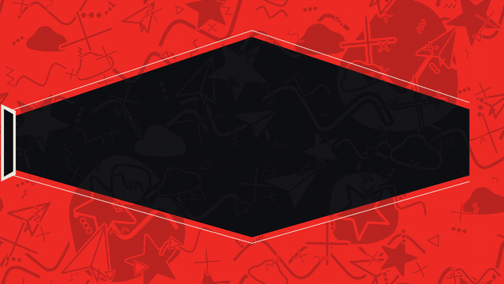

# Diamond lens · `XM.lens`



A diamond-shaped window wipes open on an accent field, a trail of icons dashes through it, and one English word slams in letter by letter.

## When to use

- One keyword that should arrive with speed and punch ("SHIP IT", "FASTER", "LIVE").
- Optionally flip it (`invert`) when the next sentence looks at the same word from another angle.
- Once per video, twice at most (second time on another stage, without `invert`).
- English only, 3–9 letters. CJK text raises a render error. Long phrases: split into two shots.

## Usage

```js
// timeline.js
const T = { in: 0, invert: 2.9 };

// scene.js
const lens = XM.lens({
  at: T.in, word: 'SHIP IT', icon: 'plane',
  doodle: { motifs: ['plane', 'cloud', 'star', 'plus', 'wave'] },
  invert: { at: T.invert },        // flip to paper + hand-lettered tag over "SHIP"
  hud: false,
});
XK.seq([{ shot: lens, t0: T.in, drift: false }]);
window.SFX_CUES.push(...lens.cues);
```

Default beats with `at = 0`: window opens 0–0.45 s, icon trail 0.35–1.05 s, letters from 1.35 s every 0.14 s, the lead icon bursts out after the last letter. Use `letters: [t, …]` to put each letter on the voice.

## Options

| option | default | what it does |
|---|---|---|
| `word` | required | the keyword; uppercased; a space adds a small gap |
| `icon` | required | what runs through the window: `'app'`, `'arrow'`, `'cursor'`, any `XM.KIT.MOTIFS` name, a draw function `(g, x, y, s, { col, flip }) => {}`, or `false` |
| `at` | `0` | window starts to wipe open |
| `doodle` | none | background pattern: `{ motifs: [...] }` or `draw(g, W, H)`; coloured automatically |
| `pass` | `{ at: at + .35, dur: .7 }` | the first dash of the icon trail; `false` skips it |
| `dir` | `1` | first dash direction: `1` left to right, `-1` right to left |
| `letters` / `per` | — / `.14` | exact time per letter, or the gap between letters |
| `burst` | after last letter | the lead icon breaks out of the right edge; `false` stops it |
| `invert` | none | `{ at }` flips to a paper field with ink letters |
| `tag` | on with `invert` | `{ at, text, span: [i0, i1] }` hand-lettered accent block over part of the word (default: first word, or first half); `false` turns it off |
| `tone` | `'accent'` | `'accent'` full accent field, `'ink'`, or `'paper'` |
| `colors` | — | `{ accent: '#hex' }` for this shot only |
| `hit` | `false` | hook mode: faster wipe, halftone leading edge, jagged glitch frame, one-frame invert |
| `hud` | `{ tl: 'FIG' }` | corner labels; `false` turns them off |

Available motif names: `wifi cursor bubble clock cup battery zzz plane at hourglass smile bolt star mail bell power cloud search pin check hash loading moon cross plus zig arrow spiral dots wave tri`.

## Style

- Anton letters stretched to fill the window height at their position (tall in the middle, shorter at the tips), each with clipped corners and a knife cut; each letter overlaps the one before with an ink seam.
- The trail goes from a dark shade of the accent to cream; fine horizontal scanlines over the field.
- The tag uses Sedgwick Ave Display in the accent colour with a thick ink outline.
- Pairs well with a calm big-type shot right after it.

## Notes

- Pick an icon that belongs to the word (a plane for "SHIP", a cursor for "CLICK"); `false` if nothing fits.
- Letters do not bounce or shake; they settle from 1.4× scale in 0.24 s.
- Cues: a whoosh for the trail, a sparkle when the word is complete, a snap on `invert`. No sound per letter.
