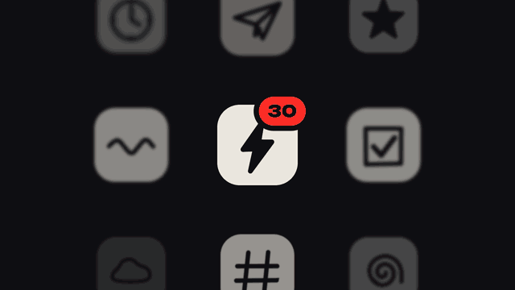

# Dot-matrix notify · `XM.notify`



One rounded tile (with an optional counting badge) pulls back into a grid of tiles, then the camera pushes into the centre tile until its face dissolves into a full-screen LED wall whose dots spell a word or icon.

## When to use

- "From one to many": a number climbing, one app becoming a wall of them, information overload.
- It lands on a conclusion: a short word, a number or an icon spelled in dots.
- Once per video. Do not put another full-screen motion shot right before or after it.

## Usage

```js
// timeline.js
const T = { in: 0, badge: .5, grid: 2.4, wall: 3.7, shape: 4.5 };

// scene.js
const notify = XM.notify({
  at: T.in, icon: 'bolt',
  badge: { at: T.badge, count: { from: 1, to: 30, plus: false } },
  grid: { at: T.grid, n: 3 },
  glyph: ['clock', 'plane', 'star', 'wave', null, 'check', 'cloud', 'hash', 'spiral'],
  wall: { at: T.wall },
  shape: { text: 'CODE', at: T.shape },
  hud: false,
});
XK.seq([{ shot: notify, t0: T.in, drift: false }]);
window.SFX_CUES.push(...notify.cues);
```

It is one continuous camera move. If you only give `at`, the beats chain themselves (tile → count → pull back → push → shape). To sync with a voice, give `grid.at`, `wall.at` and `shape.at` together.

## Options

| option | default | what it does |
|---|---|---|
| `at` | `0` | a dot appears, stretches to a bar and becomes the tile |
| `icon` | plain tile | knockout on the centre tile: an `XM.KIT.MOTIFS` name, 1–2 characters, or `(g, cx, cy, s, col) => {}` |
| `badge` | none | `true` (dot), `'text'`, `{ at, steps: [[t, 'text'], …] }`, or `{ at, count: { from, to, per, fast, plus } }`: slow-then-fast counter, last step shows `to+` unless `plus: false` |
| `grid` | after the badge | `{ at, n }` pull back to an n×n grid (odd n: 3, 5, 7); `false` skips it |
| `glyph` | shaded tiles | what is drawn on the grid tiles: one value for all, or a row-major array of n×n (`null` = empty) |
| `wall` | `grid.at + 1.3` | `{ at }` push into the centre tile; its face dissolves into LED dots with a fisheye bulge |
| `shape` | required | `{ at, text \| motif \| bits, px }`: what the lit dots spell. `text` up to 5 Latin characters; `motif` (`bell`, `bubble`, `mail`, `heart`, `check` are cleanest); `bits: ['..#..', …]` for your own |
| `doodle` | none | faint background pattern behind the first tile |
| `colors` | from theme | `{ accent, lit, off, badge }` |
| `tone` | `'ink'` | `'ink'`, `'paper'` or `'accent'` |
| `pace` | fast | `'slow'` stretches the pull-back and push for long voice lines |
| `hit` | `false` | hook mode: two colour swaps after the shape appears |
| `hud` | `{ tl: 'FIG' }` | corner labels; `false` turns them off |

## Style

- Cream tiles on ink, accent badge pill; grid tiles in mixed greys and focus depths.
- The LED wall: round dots with depth-of-field falloff toward the edges and a gentle barrel bulge. Unlit dots are a dark accent tint, lit dots cream; the shape lights up from the centre outward without flashing.
- Motion is "slow, then fast": a slow 1.1 s pull-back, then a 0.55 s accelerating push that brakes at the end. Light radial motion blur only on the fastest frames.
- Glyphs use the FusionPixel pixel font (one glyph pixel = one dot).

## Notes

- The wall is readable about 0.6 s after `wall.at`. If the voice says "everywhere" at time X, put `wall.at` 0.5–0.8 s earlier.
- Keep `shape.text` short. Five Latin characters fill the frame; more gets cramped.
- Keep the badge short (≤ 3 characters); put big numbers into `shape` instead.
- Changing one beat time does not move the later ones; set them together.
- Use `drift: false`; the component already pushes in slowly by itself.
- Each dot is drawn every frame (up to ~1900), so expect 0.05–0.2 s per frame.
