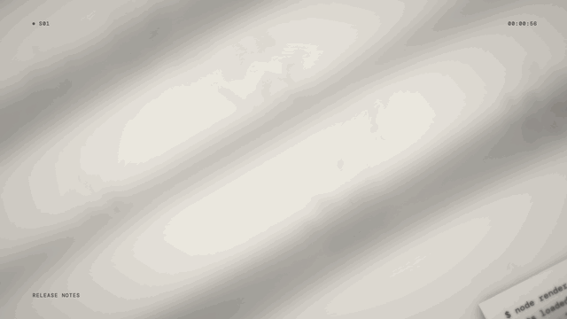

# Paper Pile · `XM.paperPile`



Printed sheets fly in at angles and settle into a messy pile. The pile dims, then a small number and one huge translucent word are stamped across it.

## When to use

- "A mountain of material all says the same thing": many docs, reports or logs, and one conclusion on top.
- Closing a section that showed several pieces of evidence: pile them up and stamp the takeaway.
- Not for reading the sheets. They're texture, and the stamped word is the message. Use `XS.doc` / `XS.evidence` when a sentence must be read.

## Usage

```js
// timeline.js
const T = { pile: 0.1, dim: 1.3, small: 1.9, word: 2.1 };

// scene.js: typeset your own sheets (or use image sheets: { src, crop, w })
const README = ['# fifi-video', '', 'Motion graphics as code.', 'Every frame is drawn from t.', '', '## Quick start', '',
  '$ bash scripts/new_project.sh my-video', '$ bash scripts/build.sh my-video', '', '1920×1080 · 30 fps · MIT'];
const CHANGES = ['CHANGELOG', '', 'v0.1', '', '+ 29 animation components', '+ frame-accurate sound cues',
  '+ stills before full renders', '- no timeline editor', '- no keyframes'];
const CODE = ['// timeline.js', 'const T = {', '  title: 0.2,', '  word: 1.0,', '  land: 2.7,', '};', '', '// scene.js', 'XK.seq([', '  { shot: a, t0: T.title },', ']);'];
const LOG = ['$ node render_frames.js demo', 'fonts loaded', 'rendering 1920×1080 @ 30 fps', 'frame 0001 / 0144', 'frame 0072 / 0144', 'frame 0144 / 0144', 'done'];
const pile = XM.paperPile({ tone: 'paper',
  papers: [
    { doc: { w: 900, h: 620, lines: LOG, size: 30, pad: [64, 80], fam: 'Mono' } },
    { doc: { w: 860, h: 700, lines: CODE, size: 32, pad: [70, 84], fam: 'Mono' } },
    { doc: { w: 940, h: 660, lines: CHANGES, size: 32, pad: [70, 84], fam: 'Mono' } },
    { doc: { w: 900, h: 700, lines: README, size: 32, pad: [70, 84], fam: 'Mono' } },
  ],
  pile: { mode: 'scatter', at: T.pile, stagger: .18 },
  dim: { at: T.dim, dur: .9, from: 'paper', under: .16 },
  words: { text: 'OPEN', at: T.word, font: 'song', alpha: .55 },
  small: { text: 'v0.1', at: T.small, size: 220 },
  hud: { tl: 'S01', bl: 'RELEASE NOTES' } });
XM.tex.use(pile, { stage: { kind: 'paper', stains: .4, seed: 3 }, light: { angle: -30, dark: .3 }, post: 'deep' });
XK.seq([{ shot: pile, t0: 0, tin: 'cut', drift: false }]);
window.SFX_CUES.push(...pile.cues);
```

## Options

| option | default | what it does |
|---|---|---|
| `papers` | required | Array order is stacking order (later sheets on top). Image sheet: `{ src, crop, w, margin, gray }`. Document sheet: `{ doc: { w, h, lines, size: 22, pad, fam } }`. In `lines`, `**bold**` works. |
| `papers[i]` placement | auto | `x, y, rot`, plus entry `at, dur, pow` (2.8–3.3) and `from: { dx, dy, rot }` to place a sheet by hand |
| `pile` | `{ mode: 'scatter' }` | `{ at, stagger: .2, center: [x, y], spread, from: 'auto' \| 'left' \| 'right' \| 'top' \| 'bottom', w, maxRot: 22 }` |
| `dim` | none | `{ at, dur, from: 'paper', under: .18 }`: fades into the `post` set by `XM.tex.use` (use `'deep'` for a heavy vignette) |
| `words` | none | The stamped word: `{ text, at, font: 'song', box, size, color: 'accent', alpha: .42, enter: 'sweep' \| 'cut', rot, out }`. `'\n'` breaks a line. |
| `small` | none | Small number or year on top: `{ text, at, x, y, size: 200, fam: 'NumIt', color, over: true }` |
| `under` | none | What lies under the pile: `{ draw(g, t, P) }` or `{ src, x, y, w, h }` |
| `cam` | none | Slow move of the pile only: `{ t0, t1, from: { s, x, y, rot }, to: {…} }` |
| `print` | `{ soft: .4, tex: .05 }` | Slight print blur and paper grain on the pile |
| `tone` | `'paper'` | Stage: `'paper'`, `'ink'` or `'accent'` |
| `sfx` | sheet sound + `sparkle` | `{ pile, words }` sound names, or `false` |
| `hud` | required | Corner labels `{ tl, bl, br }` |

## Style

- Sheets settle on `((te − t)/(te − at))^pow`, the way a tossed sheet slows down. Each has two soft shadows and a faint grain, and image sheets are multiplied onto the paper colour.
- The stamped word is a condensed Noto Serif SC 900 in the accent colour at about 42 % opacity: light at the top, solid in the middle, fading at the bottom. Letters resolve from blur 2.7 frames apart.
- The small number is DM Serif Display Italic in ink. The stamped layer is drawn after the dim, so it never gets darkened.
- Pairs well with paper + window light (`XM.tex.use`) and a big-type shot right after.

## Notes

- Use your own text or screenshots you're allowed to show. Image sheets follow the sharpness rule: magnification ≤ 1.1.
- Full stops at the end of `words.text` are removed. Readable text should be ≥ 56 px.
- No drop shadow or glow on the stamped words.
- Use `drift: false` in `XK.seq`. Use `cam` for movement.
