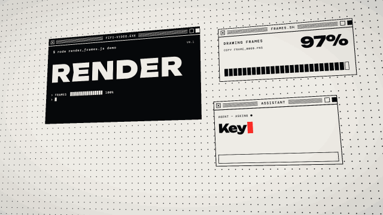

# Window barrage · `XM.popups`



Retro system windows pop up one after another on a tilted dotted desk; `XM.loading` follows with a big progress window whose counter rolls to 99 and flips to a "done" panel.

## When to use

- "Information overload", "notifications everywhere", "an agent opens ten windows and gets to work".
- An error or a question popping up (`alert`, `chat` windows), or a number rolling from one value to another (`counter`).
- `XM.loading`: "loading / training / exporting… done". Cut straight from `popups` to `loading`: both use the same desk, so it reads as one continuous shot.
- Not for calm explanations. It is a busy, full frame: use it once per video at most.

## Usage

```js
// timeline.js
const T = { pop: 0, w1: .2, w2: .7, w3: 1.2, w4: 1.7, load: 2.8, done: 4.4 };

// scene.js
XK.theme('night', { accent: '#FB2C26', accent2: '#FFD84A' });

const SH = {};
SH.pop = XM.popups({ at: T.pop, desk: 'paper', color: 'accent', hud: false, wins: [
  { kind: 'big', at: T.w1, title: 'FIFI-VIDEO.EXE', x: 240, y: 140,
    data: { word: 'RENDER', size: 130, prompt: '$ node render_frames.js demo', ver: 'V0.1', bar: 1, barLabel: 'FRAMES' } },
  { kind: 'progress', at: T.w2, title: 'FRAMES.SH', x: 1150, y: 170,
    data: { label: 'DRAWING FRAMES', files: ['FRAME_0000.PNG', 'FRAME_0060.PNG', 'FRAME_0120.PNG'], dur: 1.2 } },
  { kind: 'chat', at: T.w3, title: 'ASSISTANT', x: 1120, y: 520,
    data: { name: 'AGENT — ASKING', q: 'Keyframes needed?', a: 'NO. JUST CODE.' } },
  { kind: 'alert', at: T.w4, title: 'SYSTEM ALERT', x: 220, y: 600,
    data: { code: 'NOTICE · 0X01', text: 'No timeline editor', msg: 'EVERY FRAME IS A FUNCTION OF TIME', buttons: ['OK'] } },
] });

SH.load = XM.loading({ at: T.load + .1, winTitle: 'EXPORT.EXE', title: 'EXPORTING', label: 'FRAMES', sub: 'MP4 · 30 FPS · 1920×1080',
  meta: ['H.264 HIGH', 'YUV420P', 'AAC 48 KHZ'],
  keys: [[T.load + .2, 0], [T.load + .9, 80], [T.load + 1.4, 99]],
  done: { at: T.done, text: 'EXPORT DONE', sub: 'READY TO SHIP', cta: 'OPEN' }, hud: false });

XK.seq([
  { shot: SH.pop, t0: T.pop, tin: 'cut' },
  { shot: SH.load, t0: T.load, tin: 'cut' },
]);
```

All times are absolute seconds. Put each window's `at` on the word it illustrates, 0.5–0.7 s apart.

## Options

`XM.popups(o)`

| option | default | what it does |
|---|---|---|
| `at` | `0` | shot start; windows without `at` pop every 0.5 s from here |
| `wins` | `[]` | windows `{ at, kind, title, data, x, y, w, h, tilt, style, out }`; later ones sit on top |
| `kind` | — | `big` (one huge word), `text` (sentence + buttons), `progress`, `chat` (typed question + answer), `alert`, `term` (log lines), `counter` (rolling odometer), `wave`, `star`, `scan`, `radar` |
| `style` | by kind | `'dark'`, `'light'`, `'accent'`, `'lightA'` |
| `cursor` | — | `[[t, x, y, 'click'?]]` or `[[t, { win: i, at: 'button' }, 'click']]`; flies in and presses the top window's main button |
| `desk` | `'paper'` | `'paper'` (off-white dotted) or `'dark'` |
| `cam` | slow push | `{ from: { rx, ry, rz, s, x, y }, to: {…} }` desk tilt / scale over the shot |
| `color` | `'accent'` | highlight color for accent windows, selection boxes, pressed buttons |
| `hud` | corner text | `false` hides the small corner labels |

`XM.loading(o)`

| option | default | what it does |
|---|---|---|
| `at` | `0` | big window pops in |
| `title` / `label` / `sub` | `'LOADING'` / `'LOADING'` / — | top headline, status box next to the number, bottom line |
| `to`, `unit` | `100`, `'%'` | final value and unit |
| `keys` | fast to 80 %, slow to 99 % | `[[t, value], …]` counter keyframes |
| `done` | — | `{ at, text, sub, cta }`: jumps to `to`, flips to a light panel |
| `glitch` | `false` | `{ at: [t] }` one-frame RGB slice (use for hooks, not explanations) |
| `pile`, `winTitle`, `meta`, `desk`, `color`, `hud` | | background window stack, title-bar text, corner micro text, same as `popups` |

## Style

Off-white dotted desk, black / off-white / accent windows with chunky title bars. Big words use the wide display face; small text is mono. Windows pop with a two-frame selection box and an inverted mini frame, the desk slowly pushes in. Pairs well with a hard cut into `XM.loading` or into a calm single-subject shot.

## Notes

- Keep readable windows inside x 200–1500, y 150–850: the desk perspective and shot drift push the bottom-right corner off screen.
- Title bars, terminal lines and corner labels are 12–16 px decoration. Put anything the viewer must read in `word`, `text`, `q`, the percentage or `sub`.
- Only the top-most window receives a cursor click; pop the window you click last.
- `chat.a` lives in a narrow input box: keep it short.
- Light accent colors (yellow, mint) switch accent windows to black text automatically; on the paper desk they look faint, so use `desk: 'dark'`.
- `kind: 'star'` needs three.js and renders every frame; one or two per screen at most.
