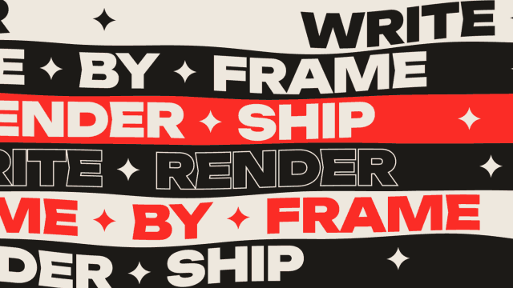

# Text ribbons · `XM.ribbons`



A full-screen wall of wavy text ribbons scrolling in alternating directions; rows swap colors, then the ribbons roll up into a spinning cylinder and the camera looks down into it to land one word.

## When to use

- A slogan or keyword everyone keeps repeating: flat wall only, `steps` push on each repetition.
- A loop / cycle / flywheel ("write → render → ship"): one step per row, `swap` → `wrap` → `inside` with the name of the loop.
- "Back where we started": `wrap` without `inside`, let it spin.
- Not for quiet moments. It fills the frame; use it once per video and put calm shots (a big word card, a screenshot) around it.

## Usage

```js
// timeline.js
const T = { wall: 0, push: .9, swap: 1.6, wrap: 2.2, inside: 3.9 };

// scene.js
XK.theme('night', { accent: '#FB2C26', accent2: '#FFD84A' });

const tag = ['', ''];   // no micro text after each unit
const SH = {};
SH.wall = XK.tone('paper', () => XM.ribbons({
  at: T.wall, count: 6, hud: false, callouts: false,
  rows: [
    { text: 'WRITE ✦ RENDER', scheme: 'paper', tag }, { text: 'FRAME ✦ BY ✦ FRAME', scheme: 'ink', tag },
    { text: 'RENDER ✦ SHIP', scheme: 'accent', tag }, { text: 'WRITE ✦ RENDER', scheme: 'outline', tag },
    { text: 'FRAME ✦ BY ✦ FRAME', scheme: 'paper-accent', tag }, { text: 'RENDER ✦ SHIP', scheme: 'ink', tag },
  ],
  steps: [{ at: T.push, push: 260, rows: 'odd' }],
  swap: { at: T.swap },
  wrap: { at: T.wrap, dur: 1.6 },
  inside: { at: T.inside, dur: .9, text: 'LOOP', sub: 'WRITE · RENDER · SHIP' },
}));

XK.seq([{ shot: SH.wall, t0: T.wall, tin: 'cut', drift: { s0: 0, s1: .04, x: 0, y: 0 } }]);
```

Keep beats ≤ 1 s apart: enter → push → swap → wrap (1.6 s of motion) → inside.

## Options

| option | default | what it does |
|---|---|---|
| `at` | `0` | ribbons slide in from both sides (0.5 s) |
| `rows` | — | `[{ text, scheme, w, tag }]`, repeated to fill `count`; `✦` draws a four-point star |
| `rows[].scheme` | `'ink'` | `ink`, `paper`, `accent`, `ink-accent`, `paper-accent`, `accent-ink`, `outline`, `outline-accent`, `outline-paper` |
| `rows[].w` | `900` | Latin weight (`400` for a thin row) |
| `rows[].tag` | two micro lines | `['', '']` hides them |
| `count` | `8` | number of rows (6 rows = bigger type) |
| `speed` / `wave` / `gap` | `90` / `30` / `10` | scroll px/s, edge wave amplitude, gap between ribbons |
| `steps` | `[]` | `[{ at, push, rows: 'all' \| 'odd' \| 'even' }]` rows lurch forward |
| `swap` | — | `{ at }` (or an array) swaps foreground/background row by row; gaps turn accent |
| `wrap` | — | `{ at, dur, bg }` bends the wall into a cylinder, then spins and tilts |
| `spin` | `38` | cylinder spin, degrees per second |
| `inside` | — | `{ at, dur, text, sub }` camera moves onto the axis; word lands in the hole |
| `callouts`, `hud` | on | leader-line labels and corner micro text; `false` hides them |
| `ink` / `paper` / `accent` | theme | the three base colors |
| `hit` | `false` | RGB-split frames for openers |

## Style

Three colors only: ink, paper, accent. Latin in Unbounded 900, CJK in a condensed sans. Ribbons wave (flat in the middle, more at the edges), odd rows scroll faster the other way; the swap sweeps across each row with a slight stagger. The cylinder is unlit; inside faces are mirrored so text reads correctly. Pairs well with a still big-type card right after it.

## Notes

- Top and bottom rows are cut by the frame edge on purpose: put the line to read in the middle rows.
- Keep rows similar in length and under ~20 Latin characters: a full turn holds a whole number of units, so short rows get spaced out and long rows make the cylinder bigger.
- On the cylinder, text is texture, not reading. Say the words on the flat wall; land the takeaway with `inside.text`.
- Use the small drift shown above; the default drift reveals the background at the wall edges.
- Colors are taken when the shot is built: wrap in `XK.tone(…)` or pass `ink` / `paper` / `accent`.
