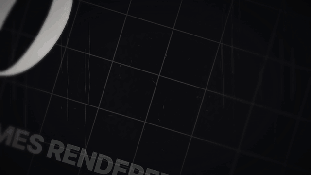

# Number Roll · `XM.numberRoll`



A large number flips through a sequence, slows down and lands on its target. It can start tilted and close up, then pull back and straighten while it counts.

## When to use

- A number that should *arrive*: a year counting back, a total climbing, a price dropping, a rank changing.
- Two or three numbers side by side that roll at the same time (before vs. after, them vs. us) using `rolls`.
- Not for a chart or a list of figures. Use a data component for that. Not for a number nobody needs to remember.

## Usage

```js
// timeline.js
const T = { enter: 0.1, flip: 0.45, land: 2.7 };

// scene.js
const roll = XM.numberRoll({ tone: 'ink',
  values: { from: 0, to: 1440, n: 22, ease: 'out', round: 1 }, fmt: { sep: ',' },
  enter: { at: T.enter }, at: T.flip, land: T.land, slow: 1.8, step: 'cut',
  align: 'left', anchor: 'final', x: 960, y: 480, size: 460,
  final: { col: 'accent' },
  label: { text: 'FRAMES RENDERED', pos: 'below', fam: 'grot', col: 'mute', gap: 120 },
  wear: .6, view: { at: T.enter }, hud: false });
XM.tex.use(roll, { stage: { kind: 'grid' }, post: XM.tex.POST.dark });   // dark grid that tilts with the numbers
XK.seq([{ shot: roll, t0: 0, tin: 'cut', drift: false }]);
window.SFX_CUES.push(...roll.cues);
```

With a single group, the roll fields go straight on the options object. For several, use `rolls: [{ values, at, land, … }, …]` with `layout: 'row' | 'column'`.

## Options

Per roll:

| option | default | what it does |
|---|---|---|
| `values` | required | `[2026, 2025, …]`, strings such as `['$9.9', …]`, `{ from, to, step }`, or `{ from, to, n, ease: 'out' \| 'in' \| 'linear', round }` |
| `at`, `land` | required | When flipping starts and when the last value lands. `times: [...]` sets every step instead. |
| `slow` | 1.5 | Last interval ÷ first interval. > 1 slows down, < 1 speeds up. |
| `step` | `'cut'` | `'cut'`, `'blur'` (resolve from blur), `'roll'` (odometer per digit), `'flip'` (the block flips over) |
| `fmt` | – | `{ dec, sep: ',', pad }`: decimals, thousands separator, zero padding |
| `prefix` / `suffix` | – | `'$'`, `'%'`, `' fps'`… or `{ text, scale: .6, raise }`. They don't flip. |
| `x, y, align, anchor, size` | auto | Position and size. `align: 'left', anchor: 'final'` centres the landed value on x. |
| `final` | – | `{ col: 'accent' }`: cross-fade to another colour on landing |
| `enter` | `{ at: at − .4, kind: 'cut' }` | How the first value appears: `'cut'`, `'fade'` or `'blur'` |
| `label` | – | `{ text, pos: 'above' \| 'below' \| 'left', size: 68, fam, col, gap }`: what the number is (≥ 56 px) |

For the whole shot:

| option | default | what it does |
|---|---|---|
| `font` | NumIt (DM Serif Display Italic) | `{ fam, w, sq: .95, track: -.06, sk: .05 }`. `'PlayItNum'` is more ornate, `'SerifSC'` gives heavy serif digits. |
| `wear` | .6 | 0 = clean glyphs, 1 = rough, printed edges with specks |
| `view` | none | Tilt + pull back: `{ at, knee, from: { zoom: 2.35, angle: 16.9 }, to: { zoom: 1, angle: 0 }, tau: .37 }` |
| `dof` | on with `view` | Side blur while the camera is close. `false` turns it off. |
| `exit` | hold | `{ kind: 'rise' \| 'blur' \| 'fade', at, dur }` |
| `tone` | `'ink'` | `'ink'`, `'paper'` or `'accent'`. The stage is drawn on the number's plane, so it tilts too. |
| `draw` | – | `(g, t, api) => {}` draws your own marks in plane coordinates. `api.box(i)` gives each value's box. |

## Style

- Narrow, high-contrast italic serif digits, slightly condensed and slanted, with a worn surface by default.
- Value changes snap to whole frames, so you get at most one change per frame. Intervals form a geometric series, which reads as slowing down.
- `view` creeps slowly, makes a sharp pull back at `knee`, then decelerates exponentially. Nothing starts or stops hard.
- No glow and no drop shadow. Use cream digits that turn accent on landing, on a dark grid or on paper.

## Notes

- `values` drawn as strings are shown exactly as written. Use `fmt` for numeric values.
- Give the landed value time to be read (≥ 1 s) before cutting away or setting `exit`.
- One `countup` sound per group, with a ding on landing, is in `roll.cues`. Set `sound: false` on a roll to mute it.
