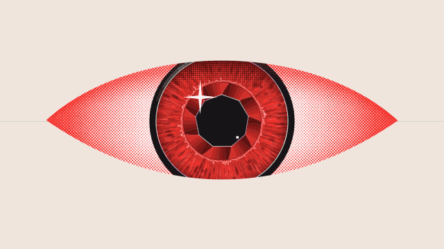

# Iris scan · `XM.scanEye`



A huge halftone eye opens, glances around while two labels point at the iris and pupil, then pushes in and a readout counts up to a value and locks.

## When to use

- "How it recognizes you", "the moment it unlocks": the readout's last key lands on the spoken number, `lock.text` is the result.
- Any accuracy / confidence / progress number you want to hit hard; add `macro` for a cut into a full-screen iris close-up while it counts.
- "Always being watched": `match: false` keeps just the eye, the glances and the labels.
- A cover-level image: once per video, at the start of a section or on its punchline. Not next to another big-number shot.

## Usage

```js
// timeline.js
const T = { eye: 0, open: .1, la: .6, lb: 1.0, m0: 1.6, m1: 2.7, lock: 2.9 };

// scene.js
XK.theme('night', { accent: '#FB2C26', accent2: '#FFD84A' });

const SH = {};
SH.eye = XK.tone('paper', () => XM.scanEye({
  at: T.eye, open: { at: T.open }, title: false,
  labels: { a: { text: 'CODE', en: 'IN', sub: ' ', at: T.la }, b: { text: 'FRAMES', en: 'OUT', sub: ' ', at: T.lb } },
  match: { keys: [[T.m0, 0], [T.m1, 100]], dec: 0, suf: '%', label: 'RENDERED', en: 'FRAMES', lock: { at: T.lock, text: 'DONE' } },
  hud: false,
}));

XK.seq([{ shot: SH.eye, t0: T.eye, tin: 'cut', drift: { s0: 0, s1: .04, x: 0, y: 0 } }]);
```

Beats: line (`at`) → eye opens → label a → label b → push in + count (`match.at`, defaults to just before the first key) → lock. Keep them under 1 s apart.

## Options

| option | default | what it does |
|---|---|---|
| `at` | `0` | a horizontal line draws out (closed eye) |
| `open` | `{ at: at + .15 }` | eye opens (0.3 s), HUD rings and a scan bar follow |
| `title` | non-English header | header text, string or `{ zh, en }`; `false` hides it |
| `labels` | non-English | `{ a, b }` each a string or `{ text, en, sub, at }`; `a` points at the iris, `b` at the pupil; `text` is 56 px |
| `match.keys` | `[[open+1, .7], [open+1.6, 97.2]]` | readout keyframes `[[t, value], …]` |
| `match.label` / `en` / `dec` / `suf` / `size` | | label, micro tag, decimals, suffix, readout size (`150`) |
| `match.lock` | last key + 0.12 s | `{ at, text }` bar fills, label becomes the lock text, rainbow ring closes; `false` = no lock |
| `match` | on | `false` = eye only |
| `subject` | — | `{ at, name, sub }` bottom-left block |
| `macro` | — | `{ at, dur: .8 }` hard cut into a full-screen iris close-up and back |
| `gaze` | auto | `[[t, dx, dy]]` eye glances (±0.15) |
| `size` | `1` | eye scale |
| `color` / `ink` | `'accent'` / `'text'` | iris color / text and HUD color |
| `hit` | `false` | faster opener timing |
| `hud` | on | `false` hides corner micro text |

## Style

Canvas 2D only. Almond eye with a 45° halftone white, fibrous iris texture derived from the accent color, nine-blade aperture pupil with rainbow edges, star highlight. Labels are slanted bold sans at 56 px; the readout is the wide display face at 150 px with an 18-cell bar. Motions: 0.3 s expo-out open, 0.45 s push-in, pupil contracts on the push. Works on night, paper and lab tones; use a saturated mid-to-dark accent (very light accents wash out the halftone).

## Notes

- Always use the small drift shown above: readable text sits about 150 px from the left and right edges.
- In an English video set `title`, both `labels`, `match.label` and `lock.text` yourself.
- Keep labels and `lock.text` to one short word; long text runs into the eye and the lock ring.
- `99.97%` is the widest readout that fits at 150 px; for four-digit integers use `size: 120`.
- The first use of an accent color builds a 2048² iris texture (about 0.3 s, once).
