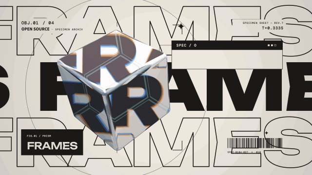

# Specimen card · `XM.specimen`



A 3D object (glass prism, marble bolt, soap-film planet or wireframe mind) floats in front of a scrolling word wall, with a label tag and a spec sheet whose rows type in one by one.

## When to use

- Introducing one thing with 2–4 key numbers ("30 fps, 1920×1080, runs in Chrome").
- Stressing one of those numbers: highlight a row with `steps: [{ at, hi: i }]`.
- Four related things: four cards in a row (`index: '01/04'…`), or `XM.specimenGrid` to put all four on one screen and swap / focus them.
- Not for sentences: values must be short. Use it once per video; don't put two "spec sheet" shots next to each other.

## Usage

```js
// timeline.js
const T = { card: 0, r0: .6, r1: 1.0, r2: 1.4, hi: 2.3, kick: 3.2 };

// scene.js
XK.theme('night', { accent: '#FB2C26', accent2: '#FFD84A' });

const SH = {};
SH.card = XK.tone('paper', () => XM.specimen({
  at: T.card, obj: 'prism', word: 'FRAMES', bg: 'bg',
  index: '01/04', kicker: 'OPEN SOURCE', label: { en: 'FRAMES' }, title: 'SPEC / OUTPUT',
  spec: [['FPS', { from: 0, to: 30, dur: .6 }], ['SIZE', '1920×1080'], ['ENGINE', 'CHROME']],
  steps: [{ at: T.r0, row: 0 }, { at: T.r1, row: 1 }, { at: T.r2, row: 2 }, { at: T.hi, hi: 0 }, { at: T.kick, kick: 90 }],
  hud: false,
}));

XK.seq([{ shot: SH.card, t0: T.card, tin: 'cut', drift: false }]);
```

Each `steps` entry is one beat; for a 4–5 s shot use 5–7 steps, 0.5–0.8 s apart.

## Options

`XM.specimen(o)`

| option | default | what it does |
|---|---|---|
| `at` | `0` | entrance: object lands, tag wipes in, spec sheet drops down |
| `obj` | `'prism'` | `'prism'` (transparent / open), `'bolt'` (speed / energy), `'planet'` (scale / ecosystem), `'mind'` (model / thinking) |
| `word` | `label.en` | word on the scrolling wall behind (one big word) |
| `label` | — | `{ en }` tag bottom-left (the main readable name) |
| `spec` | `[]` | rows `[[key, value], …]`; value can be a string, `t => string`, or `{ from, to, dec, pre, suf, dur }` to count up |
| `steps` | `[]` | `{ at, row: i }` reveal row, `{ at, hi: i }` highlight row (`-1` clears), `{ at, kick: deg }` extra spin, `{ at, ring: true }` ring pulse |
| `index`, `kicker`, `title` | | small corner / sheet-header text |
| `bg` / `ink` | `'accent'` / auto | card color and word-wall color (theme names or `#hex`) |
| `pos` / `size` | `[720, 540]` / `1` | object center and scale |
| `spin` | per object | object spin, degrees per second |
| `wordSize`, `rows`, `speed` | `400`, `['o','f','o']`, `110` | wall font size, outline / filled rows, scroll px/s |
| `whip` | off | `{ in: true }` / `{ out: t }` whip pan between consecutive cards |
| `hud` | auto | `false` hides corner micro text |

`XM.specimenGrid({ at, cards, swaps, focus, layouts, gap })`: `cards` is four `XM.specimen` option objects (no `at`); `swaps: [t, …]` reshuffles positions; `focus: [{ at, i }]` outlines one card and dims the rest (`i: -1` clears).

## Style

Wide display face (Unbounded 900) on the wall, Inter Tight for the sheet, mono micro text. The prism refracts the wall behind it with a warm/cool fringe, so give the wall strong contrast (paper card + dark wall, or dark card + light wall). Motion: 0.55 s expo-out landing, rows type in with a short scramble, highlight bar sweeps from the left. Pairs well with `XM.specimenGrid` as the recap after four single cards.

## Notes

- Keep values short (the value column is about 820 px wide at 64 px): `30`, `1920×1080`, `MIT`. Put sentences in subtitles.
- Always set `kicker` and `label.en` yourself in an English video; the defaults are not English.
- The spec sheet is pinned top-right; keep the object left of x ≈ 1000.
- Use `drift: false` in `XK.seq` if the corner text must stay fully on screen.
- In the grid only the tags are readable; explain the numbers with single cards first.
- One prism per grid if possible: each prism uploads a full-screen texture every frame.
