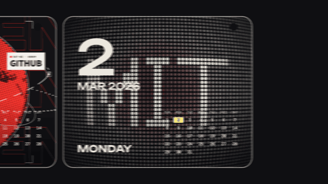

# Calendar card strip · `XM.dayStrip`



A row of rounded cards, one per day (or per version), each holding a real screenshot with a big date, weekday and a small month calendar on top; the strip stops on the cards you mention and motion-blurs past the others.

## When to use

- The voiceover walks through "several days in a row", "a few releases", "every version so far", and each day or version has a real picture to show.
- Ends nicely with a reverse whip-out, or hand off with `tin: 'whip'` in the same direction.
- Not as decoration: only use dates when the date itself carries information. Once per video at most.

## Usage

```js
// timeline.js
const T = { strip: 0, d0: 0.5, d2: 1.9, d4: 3.3, out: 4.3 };

// scene.js
SH.days = XM.dayStrip({
  at: T.strip, next: 'left', face: 'cal', tone: 'ink',
  cards: [
    { date: '2026-03-02', src: 'assets/notify-01.png' },
    { date: '2026-03-03', src: 'assets/globe-02.png' },
    { date: '2026-03-04', src: 'assets/c-scan.png' },
    { date: '2026-03-05', src: 'assets/lens-01.png' },
    { date: '2026-03-06', src: 'assets/g-squeeze.png' },
  ],
  stops: [
    { card: 0, at: T.d0 },     // card lands (centred) at this time
    { card: 2, at: T.d2 },     // card 1 is wiped past without stopping
    { card: 4, at: T.d4 },
  ],
  exit: { at: T.out },
  minHold: 1,                  // demo pace; leave the default 2.5 s for voiceover
  hud: { tl: 'S01', bl: 'ONE WEEK' },
});
window.SFX_CUES.push(...SH.days.cues);
XK.seq([{ shot: SH.days, t0: T.strip, drift: false }]);
```

Times: `at` starts the slide-in, each `stops[i].at` is the moment that card is centred (put it on the word that names it), `exit.at` starts the whip-out.

## Options

| option | default | what it does |
|---|---|---|
| `cards` | required, ≥ 2 | `{ date: 'YYYY-MM-DD' \| big: 'v2.0', src, crop, fit, focus, note, label }`; picture can also be `clip: { dir, at }` (frame folder) or `draw(g, w, h, t, P)` |
| `stops` | required | `{ card, at, pass, dur }`; `pass: true` wipes past without stopping; cards not listed are wiped past |
| `hud` | required | `{ tl, bl, br }` corner text; a card's `label` replaces `br` while it is stopped |
| `next` | `'right'` | side the next card sits on; `'left'` makes dates grow to the left (strip scrolls right) |
| `card` | `{ w: 1110, h: 891, gap: 37, r: 60 }` | card size, gap and corner radius |
| `center` | frame centre | where the stopped card sits |
| `tone` | `'ink'` | stage: `ink` / `paper` / `accent` |
| `hi` | `true` | today's cell in the month calendar is highlighted in fluorescent yellow |
| `move` | `{ seg: .5, pass: .3, sharp: 3 }` | seconds per card, speed through passed cards, S-curve sharpness |
| `enter` | `{ from: -2, ease: 'decay' }` | slide in from 2 cards away; `false` = first card already in place |
| `exit` | none | `{ at, dist: 3.5, dur: .55, dir: -1 }` reverse whip-out |
| `blur` | `{ shutter: .5, max: 320 }` | motion blur = per-frame travel × shutter; `false` turns it off |
| `minHold` | `2.5` | minimum stop length; shorter stops log a warning |
| `sfx` | `{ enter: 'zip', roll: 'ratchet', stop: 'snap', exit: 'whip' }` | returned in `.cues`; any item can be `false` |

## Style

- Glass-edged rounded cards with a punched hole top right; cream text over the picture: big date (Unbounded), month and year, weekday, small month grid.
- Card-to-card moves are S-curves that fully blur at top speed; passed cards keep their momentum.
- Weekdays and month grids are computed from a real calendar, so every date is correct.
- Pairs with `whip` (same direction) and with full-screen big type before or after.

## Notes

- Use dark pictures: cream date text sits directly on the image and is hard to read on white web pages. Darken light screenshots first.
- Pictures are cropped to cover the card; screenshots scaled above 1.1× warn, above 1.25× fail. Use `focus: [fx, fy]` to choose what stays in frame.
- Writing a `weekday` that does not match the date is an error.
- Fast passes between cards of very different brightness count toward the photosensitivity limit (3 jumps per second).
- Use the horizontal calendar layout shown here (`face: 'cal'`).
