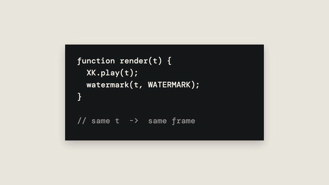

# Highlight Tags · `XM.tag`



Short labels laid over any shot: a torn paper strip that comes into focus and sways gently, or a flat slanted bar that slides in. Both can highlight one word in fluorescent yellow.

## When to use

- Stamping a two- or three-word verdict next to the subject ("PURE FUNCTION", "ANY FRAME").
- Two short remarks in a row, stacked like a staircase (`stack: 'step'`), optionally pinned across a cut.
- An either/or question: two labels offset diagonally with a small italic question between them (`pair`).
- Not for sentences or subtitles. A tag is a short phrase, and it warns when the text is long. Keep to at most 3–4 per screen (2 for stacks and pairs).

## Usage

A tag is an overlay, not a shot. Draw it inside your own shot, or attach it to a ready-made shot with `XM.tag.on`.

```js
// timeline.js
const T = { a: 0, a1: 0.35, a2: 1.15, b: 2.5, b1: 2.7 };

// scene.js: ① inside your own shot (draw it before the subject if the subject should cover it)
function codeCard(g, x, y, w, h) {          // the subject: a code card drawn on canvas
  g.fillStyle = '#16171a'; g.fillRect(x, y, w, h);
  g.font = '500 46px Mono'; g.fillStyle = '#F3EEE3'; g.fillText('function render(t) {', x + 70, y + 110);
}
const tags1 = XM.tag([
  { text: 'PURE FUNCTION', hi: 'PURE', sub: 'no hidden state', at: T.a1, x: 1180, y: 190 },
  { text: 'ANY FRAME', at: T.a2, x: 240, y: 760, rot: -2 },
], { style: 'paper' });
const P1 = XM.DS.tone('paper');
const shot1 = XM.shot({ bg: P1.bg, stage: 'flat' }, () => (g, t) => {
  XM.DS.stage(g, P1); codeCard(g, 380, 260, 1160, 560); tags1.draw(g, t, P1);   // codeCard = your own subject
});

// ② an either/or pair, hard cut in
const tags2 = XM.tag([
  { text: 'KEYFRAMES', at: T.b1, x: 560, y: 380 },
  { text: 'CODE', hi: 'CODE', at: T.b1 + .5 },
], { style: 'bar', enter: 'cut', pair: { q: 'which one scales?' } });
const P2 = XM.DS.tone('ink');
const shot2 = XM.shot({ bg: P2.bg, stage: 'flat' }, () => (g, t) => { XM.DS.stage(g, P2); tags2.draw(g, t, P2); });

XK.seq([{ shot: shot1, t0: T.a, tin: 'cut', drift: false }, { shot: shot2, t0: T.b, tin: 'cut', drift: false }]);
window.SFX_CUES.push(...tags1.cues, ...tags2.cues);

// ③ on a ready-made shot (big type, evidence, …): drawn just before that shot's HUD
// const ev = XM.tag.on(XS.evidence({ … }), [{ text: 'MIT', at: T.x, x: 900, y: 300, style: 'bar' }]);
```

## Options

Per label:

| option | default | what it does |
|---|---|---|
| `text` | required | A short phrase |
| `at` | `o.at + i × stagger` | Appear time in seconds |
| `x`, `y` | required | Anchor position. The pair or stack partner can leave them out. |
| `anchor` | `'tl'` | Which point of the label sits on (x, y): `'tl' 't' 'c' 'r' 'br' 'pin'`… |
| `hi` | none | Highlighted part in fluorescent yellow: a substring, the last n characters, or indices |
| `sub` | none | Small italic English line under a paper tag (decorative) |
| `size` | paper 84 / bar 100 | Font size in px. Readable text should stay ≥ 56. |
| `rot` | 0 | Tilt in degrees. ±1–4 is enough. |
| `from` | `'left'` | Bar slide direction: `'left'` or `'right'` |
| `enter` | animated | `'cut'`: the first frame is already settled (no focus pull, slide or sway) |
| `out` | none | Exit time, or `{ at, mode: 'blur' \| 'slide' \| 'fade' \| 'cut' }` |
| `point` | none | `{ x, y }`: one thin line to a point on the subject |

For the whole group (second argument):

| option | default | what it does |
|---|---|---|
| `style` | `'paper'` | `'paper'` or `'bar'` |
| `at`, `stagger` | –, .8 s | Times for items without their own `at` |
| `stack` | none | `'step'` or `{ dx: 1.3, dy: 2.3, dir: 'rd' \| 'ld' \| 'ru' \| 'lu' }`: each later label steps off the previous one |
| `pair` | none | `{ q: 'English question?', dir: 'rd' \| 'ld' }`: exactly two labels plus the question between them |
| `pin` | false | Draw after the texture layer's push, so the labels stay screen-fixed. Use `XM.tag.on([shotA, shotB], …)` to hold them across a cut. |
| `map` / `occlude` | none | Pin labels to a moving screenshot (`map: ev.toStage`), or let a subject silhouette cover them |
| `sfx` | `tik` | `false` turns it off |

## Style

- **paper**: rough-edged ink strip, condensed Noto Serif SC 900 in cream, and a small yellow pin dot at the top left. It focuses in from blur over .5 s, drifts up from the lower right, then sways slowly (never a fast shake).
- **bar**: flat dark bar, slanted heavy sans and a small cream square half outside the bar. It slides in with a slow start, a fast middle and a long tail, plus motion blur. It doesn't sway.
- Highlights are always fluorescent yellow. No drop shadows and no boxes around words. The pin's colour switches automatically to contrast with the background.

## Notes

- Returns `{ draw(g, t, P), cues, boxes(t), api }`. `XM.tag.on` returns the shot and merges the cues into `shot.cues`.
- Pinned tags need `drift: false` on their shots in `XK.seq`.
- `sub` and `pair.q` take English only. Keep them as decoration and put anything viewers must read in `text`.
- Keep labels off faces. Use at most one highlight per label.
