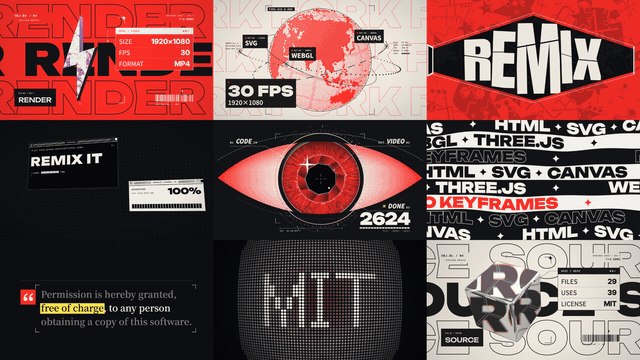

# Grid focus · `XM.thirds`



Thin thirds lines split a busy picture into nine cells; one cell (or a block of cells) stays sharp while the rest blurs, and the focus can move as the voiceover moves on.

## When to use

- A dense screenshot, page or mosaic where viewers should look at one region: "look at this table", "now further down".
- Move the focus on the words that point somewhere else; one or two moves per shot are plenty.
- Not for a single word: if the thing to point at is a keyword, highlight it in fluorescent yellow instead.
- Once or twice per video.

## Usage

```js
// timeline.js
const T = { a: 0, f1: 1.6, f2: 3.0 };   // lines draw in at a; focus moves at f1, f2

// scene.js
const CELLS = ['c-bolt', 'c-globe', 'c-lens', 'c-popups', 'c-scan', 'c-ribbons', 's-doc', 'notify-01', 'c-prism'];
const IM = CELLS.map(n => XM.image(`assets/${n}.png`));

const grid = XM.thirds({
  at: T.a, tone: 'ink',
  img: { draw: (g) => IM.forEach((m, i) => { if (m.ok) g.drawImage(m.img, (i % 3) * 640, Math.floor(i / 3) * 360, 640, 360); }) },
  lines: { x: [640, 1280], y: [360, 720] },
  focus: [[T.a, 1, 1], [T.f1, 2, 0], [T.f2, 0, 2, 1, 2]],   // [t, col, row] or [t, c0, r0, c1, r1]
  move: .5,
  enter: { mode: 'draw', dur: .5, stagger: .1 },
  outer: { blur: 14, dim: .2, feather: 3 },
  style: { lw: 3, alpha: .9, mark: 16 },
  hud: false,
});
XK.seq([{ shot: grid, t0: T.a, drift: false }]);
window.SFX_CUES.push(...grid.cues);
```

For a single screenshot use `img: { src: 'assets/page.png', crop: [x, y, w, h] }` and place `lines` so the region you want sits exactly in one cell.

## Options

| option | default | what it does |
|---|---|---|
| `at` | required | when the lines start to appear (seconds) |
| `img` | required | `{ src, crop, focus }` image (cover-fit), `{ clip: { dir, from, rate, at } }` frame sequence, or `{ draw(g, t) }` |
| `hud` | required | `{ tl, bl, br }` corner labels, or `false` |
| `lines` | thirds | `{ x: [x1, x2], y: [y1, y2] }` screen positions of the two vertical and two horizontal lines |
| `focus` | centre | `[c, r]`, a block `[c0, r0, c1, r1]`, or timed steps `[[t, c, r], [t, c0, r0, c1, r1], …]` (cells are 0..2) |
| `move` | `.5` | seconds per focus move (smooth, no overshoot) |
| `enter` | `{ mode: 'close' }` | `'close'` lines slide in from the edges; `'draw'` lines draw one by one (`dur`, `stagger`, `order`) |
| `outer` | `{ blur: 16, dim: .3, feather: 2 }` | blur radius, darkening and edge feather of the unfocused cells |
| `style` | `{ lw: 2, alpha: .6, mark: 14 }` | line width, opacity, size of the square marks on the crossings; `col` defaults to the accent, auto-switched for contrast |
| `exit` | none | `{ at, dur: .4, mode: 'open' \| 'fade' }`: the sharp area grows to full frame, or the blur clears |
| `sfx` | `{ focus: 'pop' }` | one cue per focus landing; `false` for silence |

## Style

- Thin lines with small square marks on the four crossings, in the accent colour unless it lacks contrast against the picture.
- Outer cells are blurred and slightly darkened, never desaturated: colour stays, only sharpness tells you where to look.
- Focus moves glide with an ease-in-out curve and stop dead; nothing keeps creeping after it lands.
- Works on dark mosaics and on white pages alike. Pairs well with a plain cut in and a whip or defocus out.

## Notes

- On white pages keep `outer.dim` at `.2` or below, or the outer cells turn into flat grey.
- Image upscaling above 1.1× warns, above 1.25× errors: capture screenshots at a higher scale.
- A brightness-flash check runs on enter, every move and exit; more than 3 big jumps in 1 s raises an error.
- `outer.sat` / `outer.desat` are rejected on purpose.
