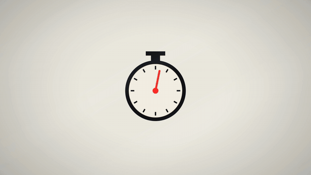

# Tilted Type · `XM.tiltWords`



Short phrases printed on tilted planes in true perspective, arranged around one subject. Each group slides in as it's spoken, groups away from the focus go soft, and the whole set can slowly pull back.

## When to use

- One object surrounded by the three or four words that describe it ("every frame / is a function / of time").
- A sentence that should build up in pieces around the thing it's about, with one piece highlighted at the end.
- Not for long text: each group is a short phrase. Not for a single punchline either; use big type (`XM.bigType`) for that.

## Usage

```js
// timeline.js
const T = { w1: 0.3, w2: 0.95, w3: 1.6, mark: 2.4, z0: 2.9, z1: 4.6 };

// scene.js
function stopwatch(g, t) { /* draw your subject around (960, 560): canvas 2D, any style */ }
const tilt = XM.tiltWords({ tone: 'paper',
  words: [
    { text: 'EVERY FRAME', at: T.w1, screen: [460, 250], rot: [18, -30, -5], size: 150 },
    { text: 'IS A FUNCTION', at: T.w2, screen: [1540, 700], rot: [8, 36, 4], size: 115 },
    { text: 'OF TIME', at: T.w3, screen: [700, 900], rot: [-38, 0, 0], size: 180, mark: { at: T.mark } },
  ],
  subject: { draw: stopwatch, box: [773, 317, 374, 430] },
  zoom: [[T.z0, 1], [T.z1, .9, 'easeIn']],
  hud: false });
XM.tex.use(tilt, { stage: 'paper', light: 'window', post: 'paper' });   // paper stage, window light, soft vignette
XK.seq([{ shot: tilt, t0: 0, tin: 'cut', drift: false }]);
window.SFX_CUES.push(...tilt.cues);
```

A cutout PNG works too: `subject: { src: 'assets/object.png', box: [x, y, w, h], shadow: { a: .22 } }`.

## Options

Per word group (`words[i]`):

| option | default | what it does |
|---|---|---|
| `text`, `at` | required | The phrase and when it appears |
| `screen` + `rot` | – | Placement: centre on screen `[x, y]` plus a tilt `[pitch, yaw, roll]` in degrees. Pitch > 0 leans the top away, yaw > 0 pushes the right side away. Optional `depth` (default 1). |
| `quad` | – | Alternative placement: the four screen corners `[[x,y]×4]` (top-left, top-right, bottom-right, bottom-left) |
| `pos` + `rot` | – | Alternative placement: a free board at `[x, y, z]` |
| `size` | – | Em height in px (at depth 1). After perspective, readable words should stay ≥ 56 px. |
| `font` | `'SerifSC'` | `'SerifSC' 'HeiSC' 'PlayIt' 'Grot' 'Mono' 'StixIt'`, weight 900. Also `squeeze`, `track`. |
| `color` | `'fg'` | `'fg' 'accent' 'mute'` or `'#hex'`. `fill: 'grad'` gives a printed gradient. |
| `enter` | `'slide'` | `'slide'` (slides toward the subject), `'light'` (lights up from a faint ghost), `'rise'`, `'cut'` |
| `mark` | none | `{ at, dur: .45 }`: a yellow highlighter sweep on the same tilted plane |
| `out` | none | Fade-out time |

For the whole shot:

| option | default | what it does |
|---|---|---|
| `subject` | none | `{ src \| draw(g, t, P, api), box \| x, y, h, keys, shadow, at, out }`. Always drawn above the words. `keys: [[t, scale, rot, dx, dy, ease]]` straightens or scales it. |
| `zoom` | none | `[[t, s, ease]]`: words and subject scale together around the frame centre (the stage stays put) |
| `focus` | `'follow'` | Focus moves to the most recently spoken group, or set `[[t, index \| 'subject']]` |
| `dof` | screen-distance blur | `{ screen: { r0, r1, max }, max: 10 }`, or `false` for no blur |
| `tone` | `'paper'` | `'paper'`, `'ink'` or `'accent'` |
| `sfx` | `'first'` | A sound on the first group only. `'each'` adds one per group, `false` turns them off. |
| `hud` | – | Corner labels `{ tl, bl, br }`, or `false` |

## Style

- Noto Serif SC 900, not condensed. All the slant comes from real perspective (a homography in a shader, not a 2D skew).
- Each group slides about 60 px toward the subject in .75 s on a `(1−k)^2.4` curve, with short motion trails while moving and sharp once settled.
- Groups far from the focus are softly blurred. The subject is always on top, and its paper shadow fades where it meets the words.
- Looks best on paper with window light (`XM.tex.use`). The highlight is always fluorescent yellow, never a box.

## Notes

- **Needs the GPU path:** render with `CHROME_ARGS='--use-angle=metal --enable-gpu --ignore-gpu-blocklist' node scripts/render_frames.js <dir>`.
- A `draw` subject needs `box` so focus and shadows know where it is.
- Leave room between groups. Perspective makes the near end of a phrase much wider than you might expect, so check stills for overlaps.
- Use `drift: false` in `XK.seq`. The component handles its own camera via `zoom`.
