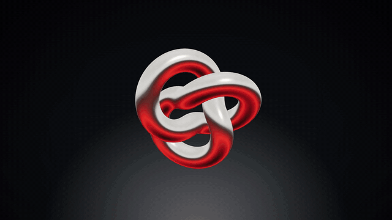

# Concept Title · `XM.titleCard`



A dark title card: one subject in the middle, a large italic concept name that resolves letter by letter, a heavy second line, and an optional thin arc sweeping in behind the subject.

## When to use

- A concept or chapter gets its name for the first time ("Timeline", "Render loop", "Part 02").
- You have one strong object for the idea, such as a 3D model, a cutout PNG or a PNG sequence.
- Use one per video. It does the same job as a big-type name card (`XM.bigName`), so pick one of the two.
- Not for sentences. The title and second line should each be a short name or question.

## Usage

```js
// timeline.js
const T = { s: 0, title: 0.2, zh: 1.0, en: 1.4 };

// scene.js: the subject here is a three.js knot rendered through the shared XM.drawGL renderer
const scene = new THREE.Scene();
scene.environment = XM.studioEnv('neutral', [[0, '#ffffff', 1.6], [.3, '#d8d6d2', 1.1], [.47, '#ffffff', 2.4],
  [.52, '#1a1a1c', .2], [.7, '#FB2C26', .9], [1, '#121214', .3]]);   // reflection bands, top to bottom
const camera = new THREE.PerspectiveCamera(30, 1920 / 1080, 0.1, 100); camera.position.set(0, 0, 13);
const knot = new THREE.Mesh(new THREE.TorusKnotGeometry(1.15, 0.36, 300, 48, 2, 3),
  new THREE.MeshStandardMaterial({ color: '#e9e6e0', metalness: 1, roughness: 0.18 }));
scene.add(knot);

const card = XM.titleCard({ tone: 'ink', layout: 'corner',
  title: { text: 'Timeline', at: T.title, size: 260 },
  zh: { text: 'ONE CLOCK', at: T.zh, fam: 'hei', size: 150, skew: 0, color: 'accent' },
  en: { text: 'every frame is a function of t', at: T.en },
  subject: { gl: { scene, camera, update: t => knot.rotation.set(.5 + t * .12, t * .45, .2) },
             box: [760, 340, 400, 400], at: T.s },
  arc: { at: T.title }, hud: false });
XM.tex.use(card, { stage: { kind: 'wash', hot: [960, 1240], lift: .42, deep: .62 },
  post: { vig: { a: .42, r0: .42, pow: 1.4, asp: .7 }, grain: { a: .012, scale: 1.5 } } });
XK.seq([{ shot: card, t0: 0, tin: 'cut', drift: false }]);
```

A PNG cutout works the same way: `subject: { src: 'assets/object.png', box: [x, y, w, h], shadow: { a: .4 } }`.

## Options

| option | default | what it does |
|---|---|---|
| `title` | required | `{ text, at, size, font: 'serif' \| 'grot' \| 'stix', enter: 'focus' \| 'fade' \| 'cut' \| 'track', slide, color }`. English only. Positions can be overridden with `left / top / cx / cy`. |
| `zh` | required | The heavy second line (a native-language name or a short question): `{ text, at, fam: 'serif' \| 'hei', size, skew, color, enter: 'focus' \| 'type' \| 'wipe' \| 'cut' \| 'track' }` |
| `en` | none | Small italic line, decorative: `{ text, at, size: 48 }` |
| `subject` | required | `src` (PNG), `seq: { files, fps }`, `draw(g, t, P)` or `gl: { scene, camera, update }`. Placement: `box: [x, y, w, h]` or `cx, cy, h`. Also `shadow`, `halo`. |
| `layout` | `'corner'` | `'corner'` (title top-left, second line bottom-right), `'side'`, `'center'`, `'spine'` (vertical title along one edge) |
| `arc` | off | `true` or `{ at, dur: 1.6, from, to, via, width, color }`: a thin line drawn in behind the subject |
| `card` | off | `true` or `{ to: .832, dur: 2.67, frost }`: a frosted-glass card that slowly recedes behind the subject |
| `tone` | `'ink'` | `'ink'`, `'paper'` or `'accent'`. Add texture with `XM.tex.use`. |
| `sfx` | title `sparkle`, second line `tik` | `{ title, zh, en, arc }`, or `false` |
| `hud` | none | Corner labels `{ tl, bl, br }`, or `false` |

**One line on its own** (`XM.trackTitle`): the tracking-in entrance without the card. Letters start packed tight and spread out to their final spacing.

```js
const tt = XM.trackTitle({ text: 'FRAME BY FRAME', at: 0.3, x: 960, cy: 540, align: 'c', size: 150, fam: 'hei', color: 'fg', ls: .22 });
// inside any shot's draw(g, t, P): tt.draw(g, t, P);   sounds: window.SFX_CUES.push(...tt.cues)
```

## Style

- Fonts: Playfair Display Italic for the title, Noto Sans or Serif SC 900 for the second line, and a small STIX italic for `en`.
- Letters arrive .055 s apart and each one goes from blurred to sharp in .15 s. The whole line glides 80 px over 1.28 s and eases out.
- Dark gradient stage with a soft vignette (`XM.tex` wash). Nothing glows and text has no drop shadow. Colours come from the theme: one accent.
- The subject always sits on top of the text. Its soft shadow fades automatically where it touches text.

## Notes

- A `gl` or `draw` subject needs `box` so the layout knows where the subject is.
- Keep `title` short. `trackTitle` warns above 16 Latin letters.
- A three.js subject renders fine with software GL, but it's faster with GPU flags: `CHROME_ARGS='--use-angle=metal --enable-gpu --ignore-gpu-blocklist'`.
- `card.api.boxes()` returns the on-screen boxes of every line and the subject, for overlap checks.
