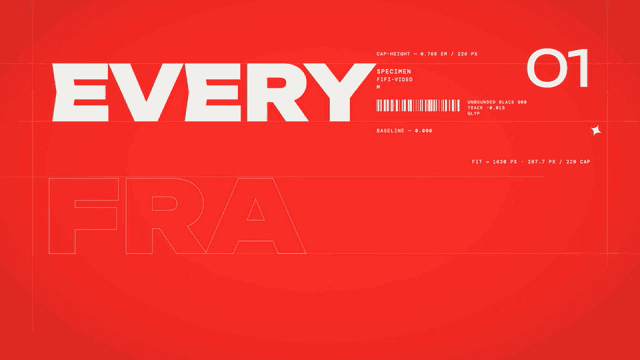

# Type Specimen · `XM.typeSpecimen`



One word treated as a type specimen sheet: outlined letters appear one by one and fill in solid, measurement labels follow, a row of tags highlights item by item, and an optional crosshair locks onto the word.

## When to use

- An English term appearing for the first time ("AGENT", "TOKEN", "FRAMES"), with a gloss or lead-in word in the kicker.
- A three-part preview ("it's pure, seekable, and just code"), with one tag per item timed to the voice.
- The "this is the one" beat: `slam` locks a crosshair onto the word.
- Not for long words (2–8 letters works best) and not for a sentence. Don't use it in the same video as another "name one word" component.

## Usage

```js
// timeline.js
const T = { at: 0.1, fill: 0.9, tag1: 1.9, tag2: 2.4, tag3: 2.9, slam: 3.6 };

// scene.js
const spec = XM.typeSpecimen({ at: T.at, word: 'FRAMES', kicker: 'EVERY',
  fill: { at: T.fill, mode: 'rise' },
  tags: { items: ['PURE', 'SEEKABLE', 'CODE'], at: [T.tag1, T.tag2, T.tag3] },
  slam: { at: T.slam, label: 'RENDERED' },
  index: '01', of: '29', spec: ['SPECIMEN', 'FIFI-VIDEO', 'MOTION AS CODE'], hud: false });
XK.seq([{ shot: spec, t0: 0, tin: 'cut', drift: { s0: 0, s1: .035, x: 0, y: -10 } }]);
```

On a light stage with an accent block sweep:
`XK.tone('paper', () => XM.typeSpecimen({ …, bg: 'bg', fill: { at, mode: 'block' } }))`.

## Options

| option | default | what it does |
|---|---|---|
| `at` | 0 | Start time: guide lines grow, then outlined letters appear one every .05 s |
| `word` | – | The main word, fitted into x 150–1770 and at most `cap` (290 px) tall. Latin uses Unbounded Black. |
| `kicker` | none | Big word at the top left: `'EVERY'` or `{ text, size }`. Readable text, such as a gloss or lead-in. |
| `fill` | `{ at: at + .9, mode: 'rise', dur: .5 }` | Outline → solid. `'rise'`: a cursor sweeps and letters rise from the baseline. `'block'`: a colour block sweeps. `false` keeps the outline. |
| `tags` | none | `{ items, at: [...], show, size: 60 }`: a row at the bottom, typed in after the fill. At `at[j]`, item j gets a solid highlight. Up to 4 items of 2–4 words each. |
| `slam` | none | `{ at, label }`: ghost outlines expand, crosshair lines sweep in, the viewfinder closes and the label types in. With `slam` and no `fill`, letters slam in skewed from the right. |
| `metrics` | true | Per-letter width labels and a total-width rule after the fill (decorative) |
| `index` / `of` / `spec` | `'01'` / `'03'` / three lines | Big number at the top right, plus three lines of small text in the right column |
| `breathe` | true | Tracking opens slightly after the fill and settles back |
| `cursor` | `'accent2'` on accent bg | Colour of the sweep cursor and reticle |
| `bg` / `fg` | `'accent'` / auto | Background, and text colour (defaults to whichever theme colour contrasts most) |
| `hit` | false | Punchier timing: one letter per frame, a push on the fill, and an RGB split on the lock frame. Use it for hooks only. |
| `hud` | corner HUD | `{ tl, bl, br }`, or `false` |

## Style

- Unbounded Black for the word and kicker. Thin guide lines, a faint grid and DM Mono micro labels give the specimen-sheet feel.
- The default stage is the theme accent with cream type. In paper tone it's ink type with an accent block sweep.
- Beats: outline letters → fill (≈ .5 s) → width labels → tags one by one → lock-on. All motion is expo-eased with no bounce.
- Works well as a chapter's first shot, followed by a calmer explainer shot.

## Notes

- **Drift:** the word spans the full width, so the default `XK.seq` drift would push letters off screen. Use `drift: { s0: 0, s1: .035, x: 0, y: -10 }`.
- Layout is measured on the first render, after fonts load. Don't try to pre-measure it in `scene.js`.
- Tags and kicker are the readable parts (≥ 56 px). The micro labels are meta information only.
- About 0.1 s per frame to render. No GPU needed.
