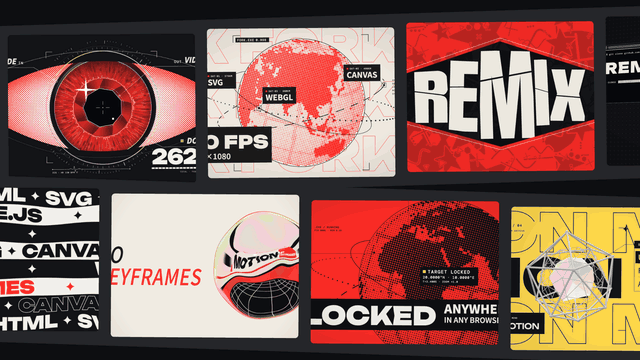

# Whole-wall swap · `XM.wall`



Two tilted strips of different screenshots slide in from opposite sides and stop; on one word, every cell hard-cuts to the same picture at the same frame.

## When to use

- "Everyone builds it differently… but underneath it's all the same thing": land the swap on the word that names that thing.
- Many different pages, tools or results collapsing into one idea.
- The cells are a pattern, not something to read. If one picture needs reading, cut to it afterwards.
- Once per video at most.

## Usage

```js
// timeline.js
const T = { wall: 0, same1: 1.6, same2: 2.5 };

// scene.js
const CELLS = ['c-bolt', 'c-scan', 'c-globe', 'c-lens', 'c-popups', 'c-prism', 'c-ribbons', 'bubble-01', 'globe-01', 'specimen-02'];
SH.wall = XM.wall({
  at: T.wall, tone: 'ink',
  cells: CELLS.map(n => ({ src: `assets/${n}.png` })),
  same: [
    { at: T.same1, src: 'assets/c-spice.png' },     // every cell swaps here
    { at: T.same2, src: 'assets/c-notify.png' },    // optional second swap
  ],
  layout: {
    list: [   // two strips: top tilted -1.8°, bottom +1.9°
      { m: [462, 322], angle: -1.776, rot: 1.30, pitch: 598.3, w: 562, h: 448, j: [-2, 2] },
      { m: [1056.5, 812], angle: 1.89, rot: -1.49, pitch: 600.0, w: 563, h: 430, j: [-2, 2] },
    ],
    radius: 10, border: false, band: { pad: 34 },
  },
  enter: { dur: .95, ease: 'decay', from: [520, -520], stagger: 0, blur: 0 },
  hud: false,
});
window.SFX_CUES.push(...SH.wall.cues);
XK.seq([{ shot: SH.wall, t0: T.wall, drift: false }]);
```

Times: `at` is when the strips start sliding in; each `same[i].at` is the swap frame (put it on the first frame of the spoken word). The returned `times.settle` tells you when the wall has stopped.

## Options

| option | default | what it does |
|---|---|---|
| `cells` | required, ≥ 2 | `{ src \| clip: { dir }, crop: [x, y, w, h], focus: [.5, .5] }`, filled cover-style; strip 1 first, then strip 2; repeats if short |
| `same` | required | `{ at, src \| clip, crop, focus, br, mark }` or an array of them; `mark: [{ box, at }]` sweeps a fluorescent-yellow highlight at the same spot in every cell |
| `hud` | required | `{ tl, bl, br }` corner text, or `false` for none |
| `layout.list` | auto | per-strip geometry: `m` midpoint, `angle`, `pitch`, cell `w` / `h`, `j` cell index range, `rot` extra photo rotation |
| `layout.band` | `false` | dark film-strip backing behind the cells, `{ pad, col }` |
| `layout.radius` / `border` | `6` / thin line | cell corner radius and outline (`false` = none) |
| `enter` | `{ dur: .8, ease: 'expoOut', dir: 'alt', stagger: .06 }` | slide-in; `from` = start offset per strip in px; `'decay'` ease gives a hard brake |
| `tone` | `'ink'` | stage: `ink` / `paper` / `accent` |
| `under` / `over` | none | `(g, t, api)` hooks to draw below or on top of the wall (e.g. a subject in front) |
| `sfx` | `{ enter: 'sheet', swap: 'snap', mark: 'paper' }` | returned in `.cues`; any item can be `false` |

## Style

- Two strips with opposite slight tilts and opposite slide directions, on a dark film-strip band; the wall stops dead after the slide-in, with no drift.
- The swap is a hard cut on all cells in the same frame. No flashes, no colour grading, no glow.
- Works best with a mix of dark and colourful stills, then swapping to one bold, simple picture so the change reads instantly.
- Pairs with a cut to a full-screen evidence card or big type that names the shared idea.

## Notes

- Fill every visible slot with a different picture; with too few cells, repeats show up while the strips slide.
- A cell scaled above 1.1× its source warns, above 1.25× fails. Use sharp, large stills.
- Each swap's brightness jump is estimated from the images; more than 3 big jumps in any 1 s is an error.
- Known issue: `enter.blur` above 0 darkens the cells while they slide. Use `blur: 0` for now.
- Use the two tilted strips with a hard-cut swap shown here.
