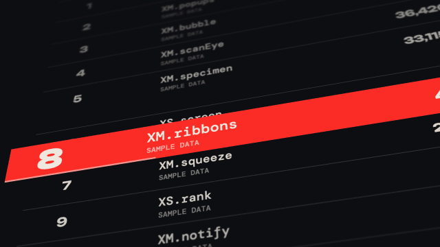

# Ranking climb · `XS.rank`



A tilted 3D leaderboard: the target row climbs past the others (each one bumped down a place), lands with a small lift-and-drop, then the camera pulls back and flattens to show the whole board, optionally cutting to the real leaderboard screenshot aligned row for row.

## When to use

- "It went straight to #1", "it broke into the top 3", "highest ranked among X": `land.at` on the moment the rank is said.
- "This is the actual leaderboard, not our drawing": add `proof` (your screenshot) and cut to it after the pull-back.
- The climb is an illustrative motion; ranks before `from` are not real history. The final board must be real data (the demo uses made-up sample data, labelled as such).
- Once or twice per video at most.

## Usage

```js
// timeline.js
const T = { rank: 0, climb: .45, land: 2.85, reveal: 3.2 };

// scene.js
XK.theme('night', { accent: '#FB2C26', accent2: '#FFD84A' });

// Sample data (made up for the demo): frames rendered per component.
const DATA = [['XM.ribbons', 48210], ['XM.globe', 45980], ['XM.popups', 41377], ['XM.bubble', 39050], ['XM.scanEye', 36420],
  ['XM.specimen', 33115], ['XS.screen', 30960], ['XM.squeeze', 28740], ['XS.rank', 26505], ['XM.notify', 24180], ['XM.lens', 21930]];
const ROWS = DATA.map(([name, n], i) => ({ rank: i + 1, name, sub: 'SAMPLE DATA', score: n.toLocaleString('en-US'), extra: 'MIT' }));
const COLS = [
  { key: 'rank', label: 'RANK', x: 154, align: 'center', w: 220 },
  { key: 'name', label: 'COMPONENT', x: 420 },
  { key: 'score', label: 'FRAMES', x: 1144 },
  { key: 'extra', label: 'LICENSE', x: 1540, align: 'center', w: 200 },
];

const SH = {};
SH.rank = XS.rank({
  at: T.rank, tone: 'ink', rows: ROWS, columns: COLS,
  target: { name: 'XM.ribbons', from: 9, to: 1 },
  climb: { at: T.climb, dur: 2.4 }, land: { at: T.land }, reveal: { at: T.reveal, dur: 1.3, fit: 'all' },
  title: { zh: 'FRAMES RENDERED', en: 'FIFI-VIDEO · SAMPLE DATA' },
  hud: false,
});

XK.seq([{ shot: SH.rank, t0: T.rank, tin: 'cut', drift: false }]);
```

## Options

| option | default | what it does |
|---|---|---|
| `at` | required | entry time |
| `rows` | required | `[{ rank, name, sub, score, err, extra, spread, tag }]`, `rank` = real final rank; include the target row |
| `target` | required | `{ name, from, to }` the row that climbs from `from` to `to` |
| `climb` | `{ at: at + .45, dur: 2.8 }` | climb, fast then slow; keep `dur` ≥ 2.4 s |
| `land` | end of climb | `{ at }` target row drops onto the board, corner marks close in |
| `reveal` | `{ at: land + .45, dur: 1.3, fit: 'all' }` | pull back and flatten; `fit`: `'all'`, `'width'` (bigger text), or a scale number |
| `columns` | 5 columns | `[{ key, label, x, align, w }]` in board coords; `key` is `rank`, `name` (with `sub`), `score` (with `err`, `tag`) or any row field |
| `geo` | `{ w: 1824, h: 1720, rowH: 106, … }` | board layout; measure it from your screenshot when using `proof` |
| `title` | — | `{ zh, en, meta }` or a string; `zh` is the main title line, `en` the small line above it |
| `proof` | — | `{ src, iw, ih, rowBox, crop, at, mode, label, mark, zoom }` real screenshot on the same board; `rowBox` = pixel box of the target's final row; `mode`: `'scan'`, `'cut'`, `'dissolve'`; `mark.kind: 'sweep'` for a yellow highlight |
| `tone` | caller | `'ink'`, `'paper'` or `'accent'` |
| `hit` | `false` | opener timing: motion blur, spring overshoot, shake |
| `hud` | on | `false` hides corner micro text |

## Style

CSS 3D board on a flat stage. Ranks and scores in Unbounded, names in DM Mono. The target row is a solid block (paper-white on ink, accent on paper). Rows fade and blur with distance from the target; the camera tilt eases out to flat during the reveal. Calm easing by default; `hit: true` restores the punchier timing. Pairs well with an `XS.screen` evidence shot of the source page.

## Notes

- With `proof`, the redraw must use the screenshot's own row height and column positions (`geo`, `columns`), and the row data must be copied from the same capture, or rows jump at the cut.
- In an English video always pass `columns` with your own labels, and set `proof.label` (or `hud: false`); the default labels are not English.
- Prefer `mark.kind: 'sweep'` over corner brackets.
- Screenshot text is often small; put the reading in the redrawn board and use the screenshot as proof.
- Only use leaderboard data and screenshots you are allowed to show.
- Credits: the motion logic is ported from [w52m/qwen3-8-max-text-arena-rank-climb](https://github.com/w52m/qwen3-8-max-text-arena-rank-climb) by Bron (`src/TextArenaRankClimb.tsx`, commit `3bddb32`). The upstream repository has no LICENSE file; used with the author's permission, including commercial use. Visuals are redrawn. Details in `components/explainer/xm-assets/rank/SOURCE.md`.
