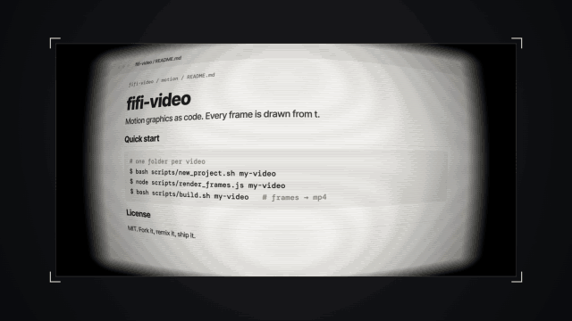

# Screen shot · `XS.screen`



A real screenshot shown as if a phone were filming a monitor (barrel fisheye, crawling moiré, vignette); the camera pushes in to the line being discussed and a fluorescent-yellow highlight sweeps across it, bending with the lens.

## When to use

- Evidence: "here is their dashboard", "this is the changelog", "someone posted this".
- Landing on one number or phrase: push to 1.6–1.8× and sweep it at the same moment.
- Dark pages (changelogs, terminals) with `page: 'dark'`; phone screenshots with `frame: 'phone'`.
- 1–3 times per video and never twice in a row; the lens wobble gets tiring.

## Usage

```js
// timeline.js
const T = { screen: 0, push: .9, pushed: 1.7, mark: 1.85 };

// scene.js
XK.theme('night', { accent: '#FB2C26', accent2: '#FFD84A' });

const SH = {};
SH.readme = XS.screen({
  src: 'assets/readme.png', iw: 3200, ih: 1800,   // our own page, rendered at 2x so the push-in stays under 1.1x
  at: T.screen, tone: 'ink', page: 'light',
  focus: [[T.push, 1600, 900, 1], [T.pushed, 1040, 580, 1.8]],
  marks: [{ x: 1436, y: 538, w: 408, h: 84, at: T.mark, dur: .5 }],   // "drawn from t." in screenshot pixels
  hud: false,
});

XK.seq([{ shot: SH.readme, t0: T.screen, tin: 'cut', drift: { s0: 0, s1: .04, x: 0, y: -16 } }]);
```

All `focus` and `marks` coordinates are screenshot pixels. Measure them on the PNG (find the row's dark pixels), then draw the boxes back on the image once to check.

## Options

| option | default | what it does |
|---|---|---|
| `src`, `iw`, `ih` | required | screenshot path and its pixel size |
| `crop` | whole image | `[x, y, w, h]`; widened to the screen box aspect (~1.97), so keep it wide |
| `at` / `out` | `0` / — | entry (corners close in, exposure rises, distortion relaxes) / 0.25 s fade out |
| `tone` | theme | stage: `'ink'`, `'paper'`, `'accent'` (light page on `ink`, dark page on `paper`) |
| `page` | `'light'` | `'light'` or `'dark'`: sets highlight blend and mark colors |
| `focus` | crop center, 1× | `[[t, ix, iy, zoom]]`; ease-in-out between keys; repeat a key to hold |
| `marks` | `[]` | `{ x, y, w, h, at, dur, opacity, out, note }` highlight sweep (always fluorescent yellow); `note: { text, x, y }` adds a leader-line label in stage coords |
| `drift` | `.035` | slow constant push per second; `0` = off |
| `pull` | `1` | `1` moves the focus point to screen center; `0` = magnifier-style |
| `fisheye` | `{ strength: .45, zoom: 1.1 }` | lens strength (can be keyframed `[[t, v]]`) |
| `moire` / `vignette` | subtle | `{ intensity, scale, angle, drift }` / `{ amount, radius, softness }` |
| `frame` | `'screen'` | `'screen'`, `'phone'` (portrait, rounded border), `'none'` |
| `box` | `[190, 150, 1540, 780]` | screen rectangle on stage |
| `hud` | on | `false` hides corner micro text |

Returns `{ L, update, toStage(ix, iy, t) }`; `toStage` maps a screenshot pixel to stage coordinates on that frame (lens included).

## Style

Dark or paper stage, the screen centered with thin corner marks. The push uses ease-in-out cubic, then a slow linear drift so reading holds never freeze. The highlight sits inside the shader, under the moiré and vignette, so it looks like it was on the screen. Pairs well with a big-type card or a calm 3D shot after it.

## Notes

- Screenshots are never scaled up more than 1.1×. On-screen scale ≈ `1540 / crop width × 1.1 × zoom`: take the screenshot at 2× (or crop tight) so your deepest zoom stays under the limit.
- Readable text should end up ≥ 56 px tall on screen; if not, crop tighter rather than zooming past 1.1×.
- Use highlight sweeps only. Two lines of a sentence = two sweeps back to back (`at2 = at1 + dur`).
- On dark pages keep `opacity` ≤ 0.6.
- In an English video pass `hud: false` or set `hud.br`; the default corner label is not English.
- Use the drift shown above; the default drift pushes the corner text off screen.
- Use only screenshots you own or may show. Keep them in your project folder, not in `components/`.
- Credits: the fisheye shader and push / highlight timing are ported from [vibe-motion/fisheye-motion](https://github.com/vibe-motion/fisheye-motion) by zjucat (commit `c163ee8`). The upstream repository has no LICENSE file; used with the author's permission, including commercial use. Details in `components/explainer/xm-assets/screen/SOURCE.md`.
