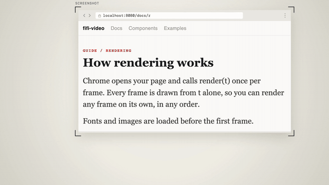

# Evidence & Quote · `XS.evidence` / `XS.doc`



Two ways to show proof. `XS.evidence` puts a real screenshot in a minimal browser frame, pushes in to the line that matters and sweeps it in yellow. `XS.doc` resets a quote in large serif type and highlights the key phrase.

## When to use

- `XS.evidence`: "the docs say…", "their changelog reads…", "someone posted…", when the viewer should *believe it's real*. You show the original screenshot.
- `XS.doc`: "the exact sentence is…", when the viewer should *read it*. The text is retyped big and clean, 2–4 lines.
- Use one of these before a conclusion shot (`XM.bigType`), never instead of one.
- Not for screenshots you'd have to enlarge past 1.1× to read. Crop tighter or recapture at a higher scale.

## Usage

```js
// timeline.js
const T = { ev: 0.1, push: 1.1, mark: 1.7, doc: 3.0, docMark: 4.0 };

// scene.js: marks and focus are in screenshot pixels
const ev = XS.evidence({ at: T.ev, tone: 'paper',
  src: 'assets/docs-page.png', iw: 2560, ih: 1600, crop: [180, 0, 1900, 1000], dw: 1240,
  url: 'localhost:8080/docs/rendering',
  focus: [[T.push, 950, 640, 1], [T.mark, 950, 640, 1.3]],
  marks: [{ x: 432, y: 601, w: 1040, h: 76, at: T.mark, mode: 'sweep' }],
  hud: false });
const doc = XS.doc({ at: T.doc, tone: 'ink',
  lines: ['A video is a list of pictures.', 'Each picture is a function', 'of one number: the time t.'],
  src: 'FIFI-VIDEO / DOCS / RENDERING',
  mark: { find: 'a function', line: 1, at: T.docMark }, hud: false });
XK.seq([
  { shot: ev, t0: 0, tin: 'cut', drift: false },
  { shot: doc, t0: T.doc, tin: 'cut', drift: false },
]);
window.SFX_CUES.push(...ev.cues, ...doc.cues);
```

The screenshot in the demo is a local HTML page captured with `node scripts/capture.js page.html docs-page.png --scale 2`.

## Options

`XS.evidence(o)`:

| option | default | what it does |
|---|---|---|
| `src`, `iw`, `ih` | required | Screenshot path and its pixel size |
| `crop` | whole image | `[x, y, w, h]`: the visible region. This sets the text size: on-screen size = source size × `dw / crop.w` × zoom. |
| `dw` | 1240 | Card width on stage (max 1640) |
| `frame` | `'browser'` | `'browser'` (thin address bar), `'phone'` or `'none'` |
| `url` | empty | Address-bar text, typed in on entry (decorative) |
| `page` | `'light'` | `'light'` or `'dark'`: brightness of the screenshot (sets highlight blend and bar colour) |
| `focus` | none | `[[t, ix, iy, zoom, ease]]`: pushes that pixel to the frame centre. 1.15–1.3 reads best. |
| `marks` | none | `[{ x, y, w, h, at, mode: 'sweep' \| 'under', lead, note: { text, x, y, at } }]`. `sweep` is always fluorescent yellow. `lead: true` draws a guide underline first. |
| `stamps` | none | `[{ text, x, y, at, rot }]`: a verdict stamp (at most 2 per video) |
| `enter` / `exit` | flat rise | `enter: 'cut'` for a hard cut. 3D paper moves: `'fly' 'line' 'pull' 'desk' 'macro' 'drum'` in, `'recede' 'fold' 'tuck' 'slide' 'dive' 'drum'` out (need GPU flags). |
| `print` | off | `{ rough, stain, band }`: old-print look for archived pages |
| `pose`, `label`, `out` | – | Card keyframes `[[t, { x, y, s, rz, op }]]`, small viewfinder label, exit time |

`XS.doc(o)`:

| option | default | what it does |
|---|---|---|
| `lines` | required | The quote, one sentence per line, 2–4 lines |
| `src` / `meta` | – | Mono source line above the quote, and small text on its right (date, page) |
| `mark` | none | `{ find: 'phrase' \| from, to, line, at, dur: .5, lead }`, or an array. The highlight sits behind the text and the text turns ink. |
| `size` / `fam` | 76 / `'serif'` | Font size (shrinks to fit, min 64). `'zh'` switches to sans for casual posts. |
| `note` / `trans` | none | `{ text, at }`: a callout label from the highlight, or a translation line under the quote |
| `push` | true | Each highlight pushes in 2.5 % and dims the other lines to 50 % |

Both take `at`, `tone: 'ink' | 'paper' | 'accent'`, `hud: { tl, bl, br } | false` and `hit`, and both return `{ L, update, cues }`. Evidence also returns `toStage(ix, iy, t)` for pinning tags on the screenshot.

## Style

- Flat stage, four thin viewfinder brackets, square corners, expo easing with no bounce or shake.
- Evidence: the card rises (.55 s), brackets close in, the screenshot "loads" top to bottom (.6 s), the URL types in, then the camera pushes in. Brackets fade once the push passes 1.04×.
- Doc: an accent quote block wipes in, the source line types out and quote lines rise .14 s apart, in Noto Serif SC (Latin from the serif face).
- Highlights are always fluorescent yellow. No boxes around keywords.

## Notes

- **Sharpness:** keep `dw / crop.w × zoom ≤ 1.1`. Recapture at `--scale 2` or `3` instead of upscaling.
- **Readability:** text the viewer must read should be ≥ 56 px on screen. Work it out from the source font size, `crop` and zoom.
- Use only screenshots you have the right to show. Mark reconstructed or illustrative material as such in the HUD.
- Use a small drift (`{ s0: 0, s1: .03 }`) or `drift: false`. Both shots already move on their own.
